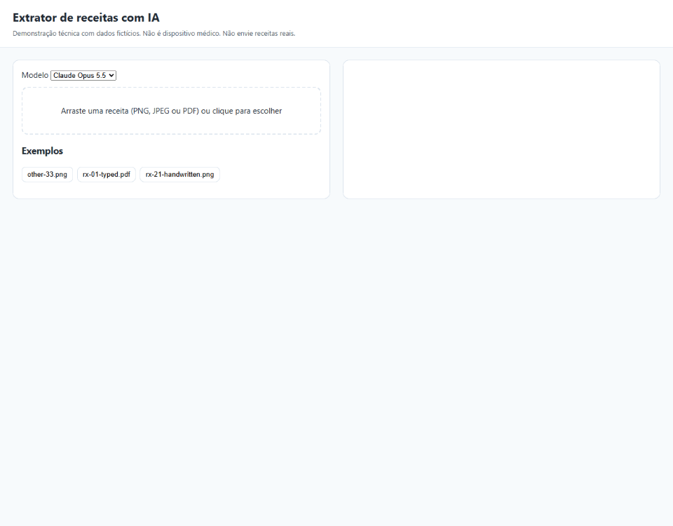
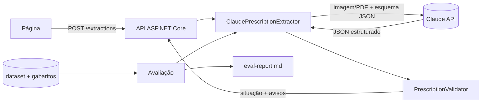

# Extrator de receitas com IA

[](https://github.com/Carlosfrayx7/extrator-receitas-ia/actions/workflows/ci.yml)

**In short:** a .NET 10 API that reads an image or PDF of a *fictitious* medical prescription and returns validated JSON with per-field confidence and domain-validation warnings. It uses the Anthropic API with strict structured outputs, and it measures its own quality: a 33-document labelled dataset compares Claude Opus 5.5 and Claude Haiku 5.5 on accuracy, cost and latency.



## O que este projeto mostra

- **Saída estruturada** com esquema JSON estrito (structured outputs da API da Anthropic).
- **Entrada multimodal**: imagem (PNG, JPEG) e PDF.
- **Validação de domínio** sobre a saída do modelo, em C# (CRM, datas, posologia, avisos de revisão).
- **Avaliação com métricas**, calibração de confiança e comparação de modelos (Opus 5.5 × Haiku 5.5).
- **Engenharia de produção**: testes sem chamar o modelo, CI, tratamento de erros e controle de custo.



## Como rodar

Requisitos: [.NET 10 SDK](https://dotnet.microsoft.com/download) e uma conta da Anthropic com créditos.

```bash
git clone https://github.com/Carlosfrayx7/extrator-receitas-ia && cd extrator-receitas-ia
ant auth login        # ou defina ANTHROPIC_API_KEY
dotnet run --project src/PrescriptionExtractor.Api
```

Abra a URL exibida no terminal (por exemplo `http://localhost:5081`), escolha o modelo e clique em um dos exemplos ou arraste uma receita (imagens PNG/JPEG até 5 MB; PDF até 10 MB e 5 páginas).

> A API não tem autenticação nem limite de requisições e foi feita para rodar localmente. Não a exponha publicamente: cada extração gasta os créditos de quem a executa.

### Como regravar a demonstração

O GIF é regravado com `docs/record-demo.mjs`, com a API rodando e credenciais configuradas. As dependências ficam fora do repositório: instale `playwright-core`, `gifenc` e `pngjs` em uma pasta e aponte `DEMO_TOOLS` para ela (opcionalmente `DEMO_URL`, padrão `http://localhost:5081`):

```bash
mkdir <pasta> && cd <pasta> && npm init -y && npm install playwright-core gifenc pngjs
DEMO_TOOLS=<pasta> node docs/record-demo.mjs
```

## Testes

```bash
dotnet test ExtratorReceitas.sln
```

Os testes rodam sem credenciais e sem rede. O teste de integração, que chama a API de verdade, só roda quando há login (`ant auth login`) ou `ANTHROPIC_API_KEY`.

## Avaliação

33 documentos fictícios (10 PDF digitados, 10 PNG digitados, 10 PNG manuscritos e 3 que não são receita), esforço `medium`, executada em 11/11/2026.

| Métrica | Opus 5.5 | Haiku 5.5 |
|---|---|---|
| Precisão por campo | 99,4% | 98,1% |
|   · PDF digitado | 100,0% | 97,1% |
|   · PNG digitado | 98,2% | 100,0% |
|   · PNG manuscrito | 100,0% | 97,3% |
| Documentos 100% corretos | 93,9% | 81,8% |
| Reconhece o que não é receita | 100,0% | 100,0% |
| JSON válido | 100,0% | 100,0% |
| Erros da API | 0 | 0 |
| Acerto quando confiança alta | 99,4% (n=497) | 98,0% (n=495) |
| Acerto quando confiança baixa | n/d | n/d |
| Latência média | 5,5 s | 3,3 s |
| Latência p95 | 8,1 s | 5,9 s |
| Tokens (entrada / saída) | 159.958 / 14.248 | 159.958 / 20.700 |
| Custo total | US$ 0,9248 | US$ 0,0263 |

O Haiku 5.5 custou 2,8% do Opus 5.5, com 1,3 ponto percentual de diferença na precisão por campo. Relatório completo, com os campos que mais erraram: [docs/eval-report.md](docs/eval-report.md).

**Limitação conhecida:** nenhum dos dois modelos declarou confiança baixa em nenhum campo, então a calibração (acerto quando a confiança é baixa) não pôde ser medida (n/d). A confiança "alta" acompanhou o acerto, mas a base não mostra se o modelo sabe avisar quando erra.

Para reproduzir (gasta créditos da Anthropic; o programa mostra a estimativa e pede confirmação):

```bash
dotnet run --project src/PrescriptionExtractor.Eval
```

## Decisões técnicas

- **Saída estruturada em vez de parse de texto**: o esquema JSON estrito garante que a resposta sempre tem o formato esperado (100% de JSON válido nos dois modelos), sem expressões regulares sobre texto livre.
- **Validação de domínio separada do modelo**: regras como CRM, UF e data ficam em C# (`PrescriptionValidator`), testáveis e determinísticas. O modelo extrai; o código confere.
- **Gateway fino para testar sem rede**: o acesso à API fica atrás de uma interface pequena, então os testes usam um gateway falso e rodam sem credenciais.
- **Sem cache de prompt**: o prefixo comum entre as chamadas é curto demais para ser armazenado, então o cache não compensaria.
- **Esforço `medium`**: equilíbrio entre latência e precisão para extração de campos, sem pagar o custo de raciocínio mais longo.

## Aviso

Demonstração técnica com dados **fictícios**. Não é dispositivo médico e não deve ser usada com dados reais de pacientes nem para decisões clínicas.

## Licença

Código sob licença [MIT](LICENSE). A fonte Caveat, usada para gerar as receitas manuscritas do dataset, está sob a SIL Open Font License 1.1 (texto em `tools/DatasetGenerator/fonts/OFL.txt`). O gerador de PDFs usa o QuestPDF sob a licença Community.
