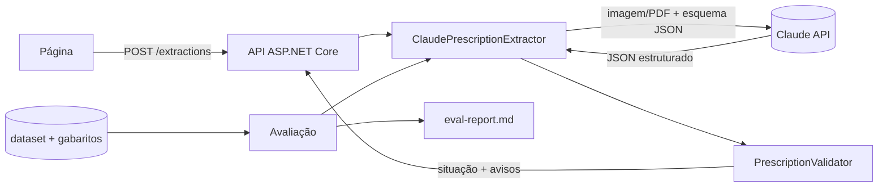

# Extrator de receitas médicas com IA - plano de implementação

> **For agentic workers:** REQUIRED SUB-SKILL: Use superpowers:subagent-driven-development (recommended) or superpowers:executing-plans to implement this plan task-by-task. Steps use checkbox (`- [ ]`) syntax for tracking.

**Goal:** API .NET que extrai dados de receitas médicas fictícias (imagem/PDF) com a API da Anthropic em JSON validado, com página web, base de teste com gabarito, avaliação Opus × Haiku, testes, CI e demonstração.

**Architecture:** `PrescriptionExtractor.Core` contém domínio, esquema, validação e o extrator, que fala com a API por uma interface fina (`IMessagesGateway`) para permitir dublê nos testes. A API minimal (`PrescriptionExtractor.Api`) e o console de avaliação (`PrescriptionExtractor.Eval`) usam o mesmo Core. Um gerador (`tools/DatasetGenerator`) produz a base fictícia com gabarito.

**Tech Stack:** .NET 10, C#, pacote NuGet `Anthropic` (SDK oficial), ASP.NET Core minimal API, xUnit, FluentAssertions, `Microsoft.AspNetCore.Mvc.Testing`, QuestPDF, SkiaSharp, GitHub Actions, Playwright (só para gravar o GIF).

**Spec:** `docs/superpowers/specs/2026-11-11-extrator-receitas-design.md`

## Global Constraints

- Target framework `net10.0` em todos os projetos; `<Nullable>enable</Nullable>`, `<ImplicitUsings>enable</ImplicitUsings>`, `<TreatWarningsAsErrors>true</TreatWarningsAsErrors>`.
- Modelos: `claude-opus-5-5` (padrão) e `claude-haiku-5-5`. Nunca outro ID, nunca sufixo de data.
- Esforço `medium`, explícito em `OutputConfig.Effort`. Não enviar `Thinking` (os dois modelos rodam adaptativo).
- Saída estruturada com `OutputConfig.Format = new JsonOutputFormat { Schema = ... }`; sem prefill de assistente.
- `MaxTokens = 4096` por extração (não usa streaming; a saída é pequena).
- Credenciais: o SDK resolve sozinho (`ANTHROPIC_API_KEY` ou o perfil do `ant auth login`, que no Windows fica em `%APPDATA%\Anthropic`). O código nunca lê, grava nem registra chave ou token. `AnthropicCredentials.Available()` (Task 6) só diz se existe alguma credencial.
- Entrada: PNG, JPEG, PDF; até 10 MB; PDF com até 5 páginas.
- Preços (US$ por 1M tokens): Opus 5.5 entrada 4,00 / saída 20,00; Haiku 5.5 entrada 0,10 / saída 0,50.
- Código e identificadores em inglês; textos da página e mensagens de erro da API em português.
- Todo commit termina com a linha `Co-Authored-By: Claude Opus 5.5 <noreply@anthropic.com>` depois de uma linha em branco.
- Todos os dados de receitas são fictícios. Nenhum dado real.

---

## Estrutura de arquivos

```
extrator-receitas-ia/
├─ ExtratorReceitas.sln
├─ Directory.Build.props                       configurações comuns (net10.0, nullable, warnings)
├─ .gitignore  .editorconfig
├─ src/PrescriptionExtractor.Core/
│  ├─ Domain/Confidence.cs                     enum Confidence
│  ├─ Domain/ExtractedField.cs                 record ExtractedField
│  ├─ Domain/Prescription.cs                   Prescription, Prescriber, PrescriptionItem, PrescriptionType
│  ├─ Domain/PrescriptionJson.cs               opções de JSON + Parse/Serialize
│  ├─ Validation/ValidationIssue.cs            Severity, ValidationIssue, ExtractionStatus, ValidationReport
│  ├─ Validation/PrescriptionValidator.cs      regras da spec seção 5
│  ├─ Extraction/ClaudeModels.cs               IDs e resolução opus/haiku
│  ├─ Extraction/ModelPricing.cs               custo estimado
│  ├─ Extraction/PrescriptionSchema.cs         esquema JSON + prompt de sistema
│  ├─ Extraction/FileRules.cs                  tipo, tamanho e páginas do arquivo
│  ├─ Extraction/ExtractionErrors.cs           exceções do domínio de extração
│  ├─ Extraction/IMessagesGateway.cs           GatewayRequest, GatewayResponse, IMessagesGateway
│  ├─ Extraction/AnthropicMessagesGateway.cs   implementação com o SDK oficial
│  ├─ Extraction/IPrescriptionExtractor.cs     interface + ExtractionResult
│  └─ Extraction/ClaudePrescriptionExtractor.cs
├─ src/PrescriptionExtractor.Api/
│  ├─ Program.cs                               endpoints, DI, tratamento de erros
│  ├─ ErrorMapping.cs                          exceção → status HTTP + mensagem
│  └─ wwwroot/index.html  wwwroot/app.js  wwwroot/styles.css
├─ src/PrescriptionExtractor.Eval/
│  ├─ Program.cs                               CLI: estimativa, confirmação, execução
│  ├─ FieldNormalizer.cs                       normalização para comparação
│  ├─ DocumentScorer.cs                        compara resultado x gabarito
│  ├─ EvalRunner.cs                            roda a base com N modelos em paralelo
│  └─ ReportWriter.cs                          gera docs/eval-report.md
├─ tools/DatasetGenerator/
│  ├─ Program.cs  FakeData.cs  PrescriptionRenderer.cs  NonPrescriptionRenderer.cs
│  └─ fonts/Caveat-Regular.ttf  fonts/OFL.txt
├─ dataset/                                    33 documentos + *.expected.json (gerados)
├─ tests/PrescriptionExtractor.Core.Tests/     testes do Core e da avaliação
├─ tests/PrescriptionExtractor.Api.Tests/      testes da API
├─ docs/demo.gif  docs/eval-report.md  docs/roteiro-video.md  docs/record-demo.mjs
├─ .github/workflows/ci.yml
└─ README.md  LICENSE
```

O projeto de testes do Core também referencia `PrescriptionExtractor.Eval` (a lógica de pontuação é testada lá).

---

### Task 1: Solução, projetos e CI

**Files:**
- Create: `ExtratorReceitas.sln`, `Directory.Build.props`, `.gitignore`, `.editorconfig`, `LICENSE` (MIT, titular "Carlos Oliveira")
- Create: os 6 projetos (`src/...Core`, `src/...Api`, `src/...Eval`, `tools/DatasetGenerator`, `tests/...Core.Tests`, `tests/...Api.Tests`)
- Create: `tests/PrescriptionExtractor.Core.Tests/SmokeTests.cs`
- Create: `.github/workflows/ci.yml`

**Interfaces:**
- Produces: a solução compilável; referências entre projetos usadas por todas as tarefas seguintes.

- [ ] **Step 1: Criar a solução e os projetos**

```bash
cd /c/projetos-ia/extrator-receitas-ia
dotnet new sln -n ExtratorReceitas
dotnet new classlib -n PrescriptionExtractor.Core -o src/PrescriptionExtractor.Core -f net10.0
dotnet new web      -n PrescriptionExtractor.Api  -o src/PrescriptionExtractor.Api  -f net10.0
dotnet new console  -n PrescriptionExtractor.Eval -o src/PrescriptionExtractor.Eval -f net10.0
dotnet new console  -n DatasetGenerator           -o tools/DatasetGenerator         -f net10.0
dotnet new xunit    -n PrescriptionExtractor.Core.Tests -o tests/PrescriptionExtractor.Core.Tests -f net10.0
dotnet new xunit    -n PrescriptionExtractor.Api.Tests  -o tests/PrescriptionExtractor.Api.Tests  -f net10.0
rm src/PrescriptionExtractor.Core/Class1.cs tests/*/UnitTest1.cs
dotnet sln add src/*/*.csproj tools/*/*.csproj tests/*/*.csproj
dotnet add src/PrescriptionExtractor.Api reference src/PrescriptionExtractor.Core
dotnet add src/PrescriptionExtractor.Eval reference src/PrescriptionExtractor.Core
dotnet add tools/DatasetGenerator reference src/PrescriptionExtractor.Core
dotnet add tests/PrescriptionExtractor.Core.Tests reference src/PrescriptionExtractor.Core src/PrescriptionExtractor.Eval
dotnet add tests/PrescriptionExtractor.Api.Tests reference src/PrescriptionExtractor.Api
dotnet add src/PrescriptionExtractor.Core package Anthropic
dotnet add tests/PrescriptionExtractor.Core.Tests package FluentAssertions
dotnet add tests/PrescriptionExtractor.Api.Tests package FluentAssertions
dotnet add tests/PrescriptionExtractor.Api.Tests package Microsoft.AspNetCore.Mvc.Testing
dotnet add tools/DatasetGenerator package QuestPDF
dotnet add tools/DatasetGenerator package SkiaSharp
dotnet add tools/DatasetGenerator package SkiaSharp.NativeAssets.Linux.NoDependencies
```

- [ ] **Step 2: Configurações comuns**

`Directory.Build.props`:

```xml
<Project>
  <PropertyGroup>
    <TargetFramework>net10.0</TargetFramework>
    <Nullable>enable</Nullable>
    <ImplicitUsings>enable</ImplicitUsings>
    <TreatWarningsAsErrors>true</TreatWarningsAsErrors>
    <LangVersion>latest</LangVersion>
  </PropertyGroup>
</Project>
```

`.gitignore`: o template `dotnet new gitignore`, mais `.env`, `*.local.json`, `docs/eval-results/*.tmp`, `node_modules/`.

Em `src/PrescriptionExtractor.Api/PrescriptionExtractor.Api.csproj`, para os testes enxergarem `Program`:

```xml
<ItemGroup>
  <InternalsVisibleTo Include="PrescriptionExtractor.Api.Tests" />
</ItemGroup>
```

E no fim de `Program.cs` da Api (a Task 7 reescreve o arquivo e mantém esta linha): `public partial class Program;`

- [ ] **Step 3: Teste de fumaça**

`tests/PrescriptionExtractor.Core.Tests/SmokeTests.cs`:

```csharp
namespace PrescriptionExtractor.Core.Tests;

public class SmokeTests
{
    [Fact]
    public void Solution_builds_and_tests_run() => Assert.True(true);
}
```

- [ ] **Step 4: Build e testes**

Run: `dotnet build ExtratorReceitas.sln && dotnet test ExtratorReceitas.sln`
Expected: build sem erros nem avisos; 1 teste aprovado.

- [ ] **Step 5: CI**

`.github/workflows/ci.yml`:

```yaml
name: ci
on:
  push:
    branches: [main]
  pull_request:
jobs:
  build-test:
    runs-on: ubuntu-latest
    steps:
      - uses: actions/checkout@v4
      - uses: actions/setup-dotnet@v4
        with:
          dotnet-version: '10.0.x'
      - run: dotnet restore ExtratorReceitas.sln
      - run: dotnet build ExtratorReceitas.sln --no-restore -c Release
      - run: dotnet test ExtratorReceitas.sln --no-build -c Release --verbosity normal
      - name: Dataset generator runs
        run: dotnet run --project tools/DatasetGenerator -c Release -- --output ${{ runner.temp }}/dataset-check
```

(O gerador só existe de verdade depois da Task 9; até lá ele é o `Hello World` do template e o passo passa.)

- [ ] **Step 6: Commit**

```bash
git add -A
git commit -m "chore: cria solução, projetos e CI

Co-Authored-By: Claude Opus 5.5 <noreply@anthropic.com>"
```

---

### Task 2: Domínio e JSON da receita

**Files:**
- Create: `src/PrescriptionExtractor.Core/Domain/Confidence.cs`, `ExtractedField.cs`, `Prescription.cs`, `PrescriptionJson.cs`
- Test: `tests/PrescriptionExtractor.Core.Tests/Domain/PrescriptionJsonTests.cs`

**Interfaces:**
- Produces:
  - `enum Confidence { High, Medium, Low }` (JSON: `"high"`, `"medium"`, `"low"`)
  - `record ExtractedField(string? Value, Confidence Confidence)` com `static ExtractedField Missing => new(null, Confidence.Low)`
  - `enum PrescriptionType { Simples, ControleEspecial, Antimicrobiano, Desconhecido }` (JSON: `"simples"`, `"controle_especial"`, `"antimicrobiano"`, `"desconhecido"`)
  - `record Prescriber(ExtractedField Name, ExtractedField CrmNumber, ExtractedField CrmState)`
  - `record PrescriptionItem(ExtractedField Medication, ExtractedField Strength, ExtractedField Form, ExtractedField Dosage, ExtractedField Duration, ExtractedField Quantity)`
  - `record Prescription(bool IsPrescription, PrescriptionType PrescriptionType, Prescriber Prescriber, ExtractedField PatientName, ExtractedField IssueDate, IReadOnlyList<PrescriptionItem> Items)`
  - `static class PrescriptionJson { JsonSerializerOptions Options; Prescription Parse(string json); string Serialize(Prescription p); }` — `Parse` lança `JsonException` para JSON inválido ou incompleto.

- [ ] **Step 1: Teste que falha**

`tests/PrescriptionExtractor.Core.Tests/Domain/PrescriptionJsonTests.cs`:

```csharp
using System.Text.Json;
using FluentAssertions;
using PrescriptionExtractor.Core.Domain;

namespace PrescriptionExtractor.Core.Tests.Domain;

public class PrescriptionJsonTests
{
    private const string ValidJson = """
    {
      "isPrescription": true,
      "prescriptionType": "antimicrobiano",
      "prescriber": {
        "name": { "value": "Dra. Helena Prado", "confidence": "high" },
        "crmNumber": { "value": "123456", "confidence": "high" },
        "crmState": { "value": "SP", "confidence": "medium" }
      },
      "patientName": { "value": "Joao Teste", "confidence": "high" },
      "issueDate": { "value": "2026-11-01", "confidence": "high" },
      "items": [
        {
          "medication": { "value": "Amoxicilina", "confidence": "high" },
          "strength": { "value": "500 mg", "confidence": "high" },
          "form": { "value": "cápsula", "confidence": "high" },
          "dosage": { "value": "1 cápsula de 8 em 8 horas", "confidence": "medium" },
          "duration": { "value": "7 dias", "confidence": "high" },
          "quantity": { "value": null, "confidence": "low" }
        }
      ]
    }
    """;

    [Fact]
    public void Parse_reads_all_fields_and_enums()
    {
        var p = PrescriptionJson.Parse(ValidJson);

        p.IsPrescription.Should().BeTrue();
        p.PrescriptionType.Should().Be(PrescriptionType.Antimicrobiano);
        p.Prescriber.CrmState.Should().Be(new ExtractedField("SP", Confidence.Medium));
        p.Items.Should().ContainSingle();
        p.Items[0].Quantity.Should().Be(new ExtractedField(null, Confidence.Low));
    }

    [Fact]
    public void Serialize_round_trips_with_snake_case_enums()
    {
        var p = PrescriptionJson.Parse(ValidJson) with { PrescriptionType = PrescriptionType.ControleEspecial };

        var json = PrescriptionJson.Serialize(p);

        json.Should().Contain("\"controle_especial\"").And.Contain("\"isPrescription\"");
        PrescriptionJson.Parse(json).Should().BeEquivalentTo(p);
    }

    [Theory]
    [InlineData("not json")]
    [InlineData("{\"isPrescription\": true}")]
    public void Parse_rejects_invalid_or_incomplete_json(string json)
    {
        var act = () => PrescriptionJson.Parse(json);
        act.Should().Throw<JsonException>();
    }
}
```

- [ ] **Step 2: Rodar e ver falhar**

Run: `dotnet test tests/PrescriptionExtractor.Core.Tests --filter PrescriptionJsonTests`
Expected: FAIL de compilação (`PrescriptionJson` não existe).

- [ ] **Step 3: Implementar**

`Domain/Confidence.cs`:

```csharp
namespace PrescriptionExtractor.Core.Domain;

public enum Confidence { High, Medium, Low }
```

`Domain/ExtractedField.cs`:

```csharp
namespace PrescriptionExtractor.Core.Domain;

public sealed record ExtractedField(string? Value, Confidence Confidence)
{
    public static ExtractedField Missing => new(null, Confidence.Low);
    public bool HasValue => !string.IsNullOrWhiteSpace(Value);
}
```

`Domain/Prescription.cs`:

```csharp
namespace PrescriptionExtractor.Core.Domain;

public enum PrescriptionType { Simples, ControleEspecial, Antimicrobiano, Desconhecido }

public sealed record Prescriber(ExtractedField Name, ExtractedField CrmNumber, ExtractedField CrmState);

public sealed record PrescriptionItem(
    ExtractedField Medication,
    ExtractedField Strength,
    ExtractedField Form,
    ExtractedField Dosage,
    ExtractedField Duration,
    ExtractedField Quantity);

public sealed record Prescription(
    bool IsPrescription,
    PrescriptionType PrescriptionType,
    Prescriber Prescriber,
    ExtractedField PatientName,
    ExtractedField IssueDate,
    IReadOnlyList<PrescriptionItem> Items);
```

`Domain/PrescriptionJson.cs`:

```csharp
using System.Text.Json;
using System.Text.Json.Serialization;

namespace PrescriptionExtractor.Core.Domain;

public static class PrescriptionJson
{
    public static readonly JsonSerializerOptions Options = new()
    {
        PropertyNamingPolicy = JsonNamingPolicy.CamelCase,
        RespectNullableAnnotations = true,
        RespectRequiredConstructorParameters = true,
        Converters = { new JsonStringEnumConverter(JsonNamingPolicy.SnakeCaseLower, allowIntegerValues: false) },
        WriteIndented = true,
    };

    public static Prescription Parse(string json) =>
        JsonSerializer.Deserialize<Prescription>(json, Options)
        ?? throw new JsonException("Resposta vazia.");

    public static string Serialize(Prescription prescription) =>
        JsonSerializer.Serialize(prescription, Options);
}
```

`RespectRequiredConstructorParameters` faz o JSON incompleto do teste lançar `JsonException`.

- [ ] **Step 4: Rodar e ver passar**

Run: `dotnet test tests/PrescriptionExtractor.Core.Tests --filter PrescriptionJsonTests`
Expected: 4 aprovados.

- [ ] **Step 5: Commit**

```bash
git add -A
git commit -m "feat(core): modelo de domínio da receita e serialização JSON

Co-Authored-By: Claude Opus 5.5 <noreply@anthropic.com>"
```

---

### Task 3: Validação de domínio

**Files:**
- Create: `src/PrescriptionExtractor.Core/Validation/ValidationIssue.cs`, `PrescriptionValidator.cs`
- Test: `tests/PrescriptionExtractor.Core.Tests/Validation/PrescriptionValidatorTests.cs`, `tests/PrescriptionExtractor.Core.Tests/TestData.cs`

**Interfaces:**
- Consumes: domínio da Task 2.
- Produces:
  - `enum Severity { Error, Warning }`
  - `record ValidationIssue(string Code, string Field, string Message, Severity Severity)`
  - `enum ExtractionStatus { Valid, NeedsReview, Invalid }` (JSON: `"valid"`, `"needs_review"`, `"invalid"`)
  - `record ValidationReport(ExtractionStatus Status, IReadOnlyList<ValidationIssue> Issues)`
  - `sealed class PrescriptionValidator(TimeProvider clock) { ValidationReport Validate(Prescription p); }`
  - Códigos: `not_a_prescription`, `no_items`, `missing_medication`, `missing_dosage`, `invalid_crm`, `invalid_state`, `invalid_date`, `future_date`, `possibly_expired`, `strength_without_unit`, `antimicrobial_without_duration`, `low_confidence`.
  - `TestData.ValidPrescription()` (em testes) devolve uma receita válida usada pelos testes seguintes.

- [ ] **Step 1: Dados de teste reutilizáveis**

`tests/PrescriptionExtractor.Core.Tests/TestData.cs`:

```csharp
using PrescriptionExtractor.Core.Domain;

namespace PrescriptionExtractor.Core.Tests;

public static class TestData
{
    public static ExtractedField F(string? value, Confidence c = Confidence.High) => new(value, c);

    public static PrescriptionItem Item(string medication = "Amoxicilina") => new(
        F(medication), F("500 mg"), F("cápsula"), F("1 cápsula de 8 em 8 horas"), F("7 dias"), F("21 cápsulas"));

    public static Prescription ValidPrescription(DateOnly? issueDate = null) => new(
        IsPrescription: true,
        PrescriptionType: PrescriptionType.Simples,
        Prescriber: new Prescriber(F("Dra. Helena Prado"), F("123456"), F("SP")),
        PatientName: F("Joao Teste"),
        IssueDate: F((issueDate ?? new DateOnly(2026, 11, 1)).ToString("yyyy-MM-dd")),
        Items: [Item()]);
}
```

- [ ] **Step 2: Testes que falham**

`tests/PrescriptionExtractor.Core.Tests/Validation/PrescriptionValidatorTests.cs`:

```csharp
using FluentAssertions;
using Microsoft.Extensions.Time.Testing;
using PrescriptionExtractor.Core.Domain;
using PrescriptionExtractor.Core.Validation;
using static PrescriptionExtractor.Core.Tests.TestData;

namespace PrescriptionExtractor.Core.Tests.Validation;

public class PrescriptionValidatorTests
{
    private readonly PrescriptionValidator _validator =
        new(new FakeTimeProvider(new DateTimeOffset(2026, 11, 11, 12, 0, 0, TimeSpan.Zero)));

    private ValidationReport Validate(Prescription p) => _validator.Validate(p);

    [Fact]
    public void Valid_prescription_has_no_issues()
    {
        var report = Validate(ValidPrescription());
        report.Status.Should().Be(ExtractionStatus.Valid);
        report.Issues.Should().BeEmpty();
    }

    [Fact]
    public void Not_a_prescription_is_invalid()
    {
        var report = Validate(ValidPrescription() with { IsPrescription = false });
        report.Status.Should().Be(ExtractionStatus.Invalid);
        report.Issues.Should().ContainSingle(i => i.Code == "not_a_prescription" && i.Severity == Severity.Error);
    }

    [Fact]
    public void No_items_is_invalid()
    {
        var report = Validate(ValidPrescription() with { Items = [] });
        report.Status.Should().Be(ExtractionStatus.Invalid);
        report.Issues.Should().Contain(i => i.Code == "no_items");
    }

    [Fact]
    public void Item_without_medication_or_dosage_is_invalid()
    {
        var item = Item() with { Medication = ExtractedField.Missing, Dosage = F(" ") };
        var report = Validate(ValidPrescription() with { Items = [item] });
        report.Status.Should().Be(ExtractionStatus.Invalid);
        report.Issues.Select(i => i.Code).Should().Contain(["missing_medication", "missing_dosage"]);
        report.Issues.Should().Contain(i => i.Field == "items[0].medication");
    }

    [Theory]
    [InlineData("123")]
    [InlineData("12345678")]
    [InlineData("12A456")]
    public void Crm_outside_4_to_7_digits_is_warning(string crm)
    {
        var p = ValidPrescription() with { Prescriber = new Prescriber(F("Dra. X"), F(crm), F("SP")) };
        var report = Validate(p);
        report.Status.Should().Be(ExtractionStatus.NeedsReview);
        report.Issues.Should().ContainSingle(i => i.Code == "invalid_crm" && i.Severity == Severity.Warning);
    }

    [Fact]
    public void Unknown_state_is_warning()
    {
        var p = ValidPrescription() with { Prescriber = new Prescriber(F("Dra. X"), F("1234"), F("XX")) };
        Validate(p).Issues.Should().ContainSingle(i => i.Code == "invalid_state");
    }

    [Theory]
    [InlineData("2026-13-01", "invalid_date")]
    [InlineData("01/11/2026", "invalid_date")]
    [InlineData("2026-11-20", "future_date")]
    [InlineData("2026-09-01", "possibly_expired")]
    public void Date_rules_are_warnings(string date, string code)
    {
        var p = ValidPrescription() with { IssueDate = F(date) };
        Validate(p).Issues.Should().ContainSingle(i => i.Code == code && i.Severity == Severity.Warning);
    }

    [Theory]
    [InlineData("500")]
    [InlineData("quinhentos")]
    public void Strength_without_unit_is_warning(string strength)
    {
        var p = ValidPrescription() with { Items = [Item() with { Strength = F(strength) }] };
        Validate(p).Issues.Should().ContainSingle(i => i.Code == "strength_without_unit");
    }

    [Theory]
    [InlineData("500 mg")]
    [InlineData("500mg")]
    [InlineData("0,5 g")]
    [InlineData("250 mcg")]
    [InlineData("5 mL")]
    [InlineData("100.000 UI")]
    [InlineData("1%")]
    public void Strength_with_known_unit_is_accepted(string strength)
    {
        var p = ValidPrescription() with { Items = [Item() with { Strength = F(strength) }] };
        Validate(p).Issues.Should().BeEmpty();
    }

    [Fact]
    public void Missing_strength_is_not_a_unit_warning()
    {
        var p = ValidPrescription() with { Items = [Item() with { Strength = new ExtractedField(null, Confidence.High) }] };
        Validate(p).Issues.Should().NotContain(i => i.Code == "strength_without_unit");
    }

    [Fact]
    public void Antimicrobial_without_duration_is_warning()
    {
        var p = ValidPrescription() with
        {
            PrescriptionType = PrescriptionType.Antimicrobiano,
            Items = [Item() with { Duration = new ExtractedField(null, Confidence.High) }],
        };
        Validate(p).Issues.Should().ContainSingle(i => i.Code == "antimicrobial_without_duration");
    }

    [Fact]
    public void Low_confidence_fields_are_flagged_for_review()
    {
        var p = ValidPrescription() with { PatientName = F("Joao Teste", Confidence.Low) };
        var report = Validate(p);
        report.Status.Should().Be(ExtractionStatus.NeedsReview);
        report.Issues.Should().ContainSingle(i => i.Code == "low_confidence" && i.Field == "patientName");
    }

    [Fact]
    public void Not_a_prescription_skips_field_rules()
    {
        var p = new Prescription(false, PrescriptionType.Desconhecido,
            new Prescriber(ExtractedField.Missing, ExtractedField.Missing, ExtractedField.Missing),
            ExtractedField.Missing, ExtractedField.Missing, []);
        Validate(p).Issues.Should().ContainSingle().Which.Code.Should().Be("not_a_prescription");
    }
}
```

Adicionar o pacote do relógio falso: `dotnet add tests/PrescriptionExtractor.Core.Tests package Microsoft.Extensions.TimeProvider.Testing`

- [ ] **Step 3: Rodar e ver falhar**

Run: `dotnet test tests/PrescriptionExtractor.Core.Tests --filter PrescriptionValidatorTests`
Expected: FAIL de compilação (`PrescriptionValidator` não existe).

- [ ] **Step 4: Implementar**

`Validation/ValidationIssue.cs`:

```csharp
namespace PrescriptionExtractor.Core.Validation;

public enum Severity { Error, Warning }

public enum ExtractionStatus { Valid, NeedsReview, Invalid }

public sealed record ValidationIssue(string Code, string Field, string Message, Severity Severity);

public sealed record ValidationReport(ExtractionStatus Status, IReadOnlyList<ValidationIssue> Issues);
```

`Validation/PrescriptionValidator.cs`:

```csharp
using System.Globalization;
using System.Text.RegularExpressions;
using PrescriptionExtractor.Core.Domain;

namespace PrescriptionExtractor.Core.Validation;

public sealed partial class PrescriptionValidator(TimeProvider clock)
{
    private const int ExpirationDays = 30;

    private static readonly HashSet<string> States =
    [
        "AC", "AL", "AP", "AM", "BA", "CE", "DF", "ES", "GO", "MA", "MT", "MS", "MG", "PA",
        "PB", "PR", "PE", "PI", "RJ", "RN", "RS", "RO", "RR", "SC", "SP", "SE", "TO",
    ];

    [GeneratedRegex(@"^\d{4,7}$")]
    private static partial Regex CrmPattern();

    [GeneratedRegex(@"\d\s*(mg|g|mcg|µg|ml|ui|%)(\b|$)", RegexOptions.IgnoreCase)]
    private static partial Regex StrengthUnitPattern();

    public ValidationReport Validate(Prescription p)
    {
        var issues = new List<ValidationIssue>();

        if (!p.IsPrescription)
        {
            issues.Add(Error("not_a_prescription", "isPrescription", "O documento não é uma receita médica."));
            return Report(issues);
        }

        if (p.Items.Count == 0)
            issues.Add(Error("no_items", "items", "Nenhum medicamento encontrado na receita."));

        CheckCrm(p.Prescriber, issues);
        CheckDate(p.IssueDate, issues);

        for (var i = 0; i < p.Items.Count; i++)
            CheckItem(p.Items[i], $"items[{i}]", p.PrescriptionType, issues);

        foreach (var (field, value) in AllFields(p))
            if (value.Confidence == Confidence.Low && value.HasValue)
                issues.Add(Warning("low_confidence", field, "Leitura com confiança baixa: revisar manualmente."));

        return Report(issues);
    }

    private static void CheckCrm(Prescriber prescriber, List<ValidationIssue> issues)
    {
        if (prescriber.CrmNumber.HasValue && !CrmPattern().IsMatch(prescriber.CrmNumber.Value!.Trim()))
            issues.Add(Warning("invalid_crm", "prescriber.crmNumber", "CRM deve ter de 4 a 7 dígitos."));

        if (prescriber.CrmState.HasValue && !States.Contains(prescriber.CrmState.Value!.Trim().ToUpperInvariant()))
            issues.Add(Warning("invalid_state", "prescriber.crmState", "UF do CRM inexistente."));
    }

    private void CheckDate(ExtractedField issueDate, List<ValidationIssue> issues)
    {
        if (!issueDate.HasValue) return;

        if (!DateOnly.TryParseExact(issueDate.Value!.Trim(), "yyyy-MM-dd", CultureInfo.InvariantCulture,
                DateTimeStyles.None, out var date))
        {
            issues.Add(Warning("invalid_date", "issueDate", "Data da receita inválida."));
            return;
        }

        var today = DateOnly.FromDateTime(clock.GetUtcNow().UtcDateTime);
        if (date > today)
            issues.Add(Warning("future_date", "issueDate", "Data da receita no futuro."));
        else if (today.DayNumber - date.DayNumber > ExpirationDays)
            issues.Add(Warning("possibly_expired", "issueDate", $"Receita emitida há mais de {ExpirationDays} dias."));
    }

    private static void CheckItem(PrescriptionItem item, string path, PrescriptionType type, List<ValidationIssue> issues)
    {
        if (!item.Medication.HasValue)
            issues.Add(Error("missing_medication", $"{path}.medication", "Medicamento não identificado."));

        if (!item.Dosage.HasValue)
            issues.Add(Error("missing_dosage", $"{path}.dosage", "Posologia não identificada."));

        if (item.Strength.HasValue && !StrengthUnitPattern().IsMatch(item.Strength.Value!))
            issues.Add(Warning("strength_without_unit", $"{path}.strength", "Concentração sem unidade reconhecida."));

        if (type == PrescriptionType.Antimicrobiano && !item.Duration.HasValue)
            issues.Add(Warning("antimicrobial_without_duration", $"{path}.duration",
                "Antimicrobiano sem duração do tratamento."));
    }

    private static IEnumerable<(string Field, ExtractedField Value)> AllFields(Prescription p)
    {
        yield return ("prescriber.name", p.Prescriber.Name);
        yield return ("prescriber.crmNumber", p.Prescriber.CrmNumber);
        yield return ("prescriber.crmState", p.Prescriber.CrmState);
        yield return ("patientName", p.PatientName);
        yield return ("issueDate", p.IssueDate);
        for (var i = 0; i < p.Items.Count; i++)
        {
            var it = p.Items[i];
            yield return ($"items[{i}].medication", it.Medication);
            yield return ($"items[{i}].strength", it.Strength);
            yield return ($"items[{i}].form", it.Form);
            yield return ($"items[{i}].dosage", it.Dosage);
            yield return ($"items[{i}].duration", it.Duration);
            yield return ($"items[{i}].quantity", it.Quantity);
        }
    }

    private static ValidationReport Report(List<ValidationIssue> issues)
    {
        var status = issues.Any(i => i.Severity == Severity.Error) ? ExtractionStatus.Invalid
            : issues.Count > 0 ? ExtractionStatus.NeedsReview
            : ExtractionStatus.Valid;
        return new ValidationReport(status, issues);
    }

    private static ValidationIssue Error(string code, string field, string message) => new(code, field, message, Severity.Error);
    private static ValidationIssue Warning(string code, string field, string message) => new(code, field, message, Severity.Warning);
}
```

Observação: o aviso de confiança baixa só aparece para campos com valor; campo vazio já é coberto pelas regras de obrigatórios.

- [ ] **Step 5: Rodar e ver passar**

Run: `dotnet test tests/PrescriptionExtractor.Core.Tests --filter PrescriptionValidatorTests`
Expected: todos aprovados.

- [ ] **Step 6: Commit**

```bash
git add -A
git commit -m "feat(core): validação de domínio da receita

Co-Authored-By: Claude Opus 5.5 <noreply@anthropic.com>"
```

---

### Task 4: Esquema JSON, prompt, modelos, preços e regras de arquivo

**Files:**
- Create: `src/PrescriptionExtractor.Core/Extraction/PrescriptionSchema.cs`, `ClaudeModels.cs`, `ModelPricing.cs`, `FileRules.cs`, `ExtractionErrors.cs`
- Test: `tests/PrescriptionExtractor.Core.Tests/Extraction/PrescriptionSchemaTests.cs`, `ModelPricingTests.cs`, `FileRulesTests.cs`

**Interfaces:**
- Produces:
  - `static class PrescriptionSchema { JsonElement Schema; string SystemPrompt; string UserInstruction; }`
  - `static class ClaudeModels { const string Opus = "claude-opus-5-5"; const string Haiku = "claude-haiku-5-5"; string Resolve(string? nameOrId); }` — `null`/`""`/`"opus"` → Opus; `"haiku"` → Haiku; ID completo aceito; outro valor lança `UnsupportedModelException`.
  - `static class ModelPricing { decimal EstimateUsd(string model, long inputTokens, long outputTokens); }`
  - `static class FileRules { const long MaxBytes = 10 * 1024 * 1024; const int MaxPdfPages = 5; string ResolveMediaType(string fileName, string? contentType); void EnsureValid(byte[] data, string mediaType); }` — devolve `"image/png"`, `"image/jpeg"` ou `"application/pdf"`; lança `UnsupportedFileException`.
  - Exceções em `ExtractionErrors.cs`: `UnsupportedFileException`, `UnsupportedModelException`, `ModelRefusalException(string? category)`, `OutputTruncatedException`, `InvalidModelOutputException`.

- [ ] **Step 1: Testes que falham**

`tests/.../Extraction/PrescriptionSchemaTests.cs`:

```csharp
using System.Text.Json;
using FluentAssertions;
using PrescriptionExtractor.Core.Extraction;

namespace PrescriptionExtractor.Core.Tests.Extraction;

public class PrescriptionSchemaTests
{
    [Fact]
    public void Every_object_is_strict_and_requires_all_properties()
    {
        foreach (var obj in Objects(PrescriptionSchema.Schema))
        {
            obj.GetProperty("additionalProperties").GetBoolean().Should().BeFalse();
            var properties = obj.GetProperty("properties").EnumerateObject().Select(p => p.Name).Order();
            var required = obj.GetProperty("required").EnumerateArray().Select(e => e.GetString()!).Order();
            required.Should().Equal(properties);
        }
    }

    [Fact]
    public void Field_value_is_nullable_and_confidence_is_an_enum()
    {
        var field = PrescriptionSchema.Schema.GetProperty("properties").GetProperty("patientName");
        field.GetProperty("properties").GetProperty("value").GetProperty("type").EnumerateArray()
            .Select(e => e.GetString()).Should().BeEquivalentTo(["string", "null"]);
        field.GetProperty("properties").GetProperty("confidence").GetProperty("enum").EnumerateArray()
            .Select(e => e.GetString()).Should().BeEquivalentTo(["high", "medium", "low"]);
    }

    [Fact]
    public void Prompt_asks_for_literal_extraction()
    {
        PrescriptionSchema.SystemPrompt.Should().Contain("literal").And.Contain("null");
    }

    private static IEnumerable<JsonElement> Objects(JsonElement e)
    {
        if (e.ValueKind != JsonValueKind.Object) yield break;
        if (e.TryGetProperty("type", out var t) && t.ValueKind == JsonValueKind.String && t.GetString() == "object")
            yield return e;
        foreach (var p in e.EnumerateObject())
        {
            if (p.Value.ValueKind == JsonValueKind.Object)
                foreach (var o in Objects(p.Value)) yield return o;
        }
    }
}
```

`tests/.../Extraction/ModelPricingTests.cs`:

```csharp
using FluentAssertions;
using PrescriptionExtractor.Core.Extraction;

namespace PrescriptionExtractor.Core.Tests.Extraction;

public class ModelPricingTests
{
    [Fact]
    public void Opus_cost_uses_4_and_20_per_million() =>
        ModelPricing.EstimateUsd(ClaudeModels.Opus, 1_000_000, 100_000).Should().Be(6.00m);

    [Fact]
    public void Haiku_cost_uses_0_10_and_0_50_per_million() =>
        ModelPricing.EstimateUsd(ClaudeModels.Haiku, 2_000_000, 1_000_000).Should().Be(0.70m);

    [Theory]
    [InlineData(null, ClaudeModels.Opus)]
    [InlineData("", ClaudeModels.Opus)]
    [InlineData("opus", ClaudeModels.Opus)]
    [InlineData("HAIKU", ClaudeModels.Haiku)]
    [InlineData("claude-haiku-5-5", ClaudeModels.Haiku)]
    public void Resolve_maps_names(string? input, string expected) =>
        ClaudeModels.Resolve(input).Should().Be(expected);

    [Fact]
    public void Resolve_rejects_unknown_model()
    {
        var act = () => ClaudeModels.Resolve("gpt-x");
        act.Should().Throw<UnsupportedModelException>();
    }
}
```

`tests/.../Extraction/FileRulesTests.cs`:

```csharp
using System.Text;
using FluentAssertions;
using PrescriptionExtractor.Core.Extraction;

namespace PrescriptionExtractor.Core.Tests.Extraction;

public class FileRulesTests
{
    [Theory]
    [InlineData("a.png", null, "image/png")]
    [InlineData("a.JPG", null, "image/jpeg")]
    [InlineData("a.jpeg", "image/jpeg", "image/jpeg")]
    [InlineData("a.pdf", "application/pdf", "application/pdf")]
    [InlineData("sem-extensao", "image/png", "image/png")]
    public void Resolves_supported_types(string name, string? contentType, string expected) =>
        FileRules.ResolveMediaType(name, contentType).Should().Be(expected);

    [Theory]
    [InlineData("a.gif", "image/gif")]
    [InlineData("a.docx", null)]
    public void Rejects_unsupported_types(string name, string? contentType)
    {
        var act = () => FileRules.ResolveMediaType(name, contentType);
        act.Should().Throw<UnsupportedFileException>();
    }

    [Fact]
    public void Rejects_empty_and_too_large_files()
    {
        ((Action)(() => FileRules.EnsureValid([], "image/png"))).Should().Throw<UnsupportedFileException>();
        ((Action)(() => FileRules.EnsureValid(new byte[FileRules.MaxBytes + 1], "image/png")))
            .Should().Throw<UnsupportedFileException>();
    }

    [Fact]
    public void Rejects_pdf_with_more_than_five_pages()
    {
        var pages = string.Concat(Enumerable.Repeat("<< /Type /Page /Parent 1 0 R >>\n", 6));
        var pdf = Encoding.ASCII.GetBytes("%PDF-1.7\n<< /Type /Pages /Count 6 >>\n" + pages);
        var act = () => FileRules.EnsureValid(pdf, "application/pdf");
        act.Should().Throw<UnsupportedFileException>().WithMessage("*5 páginas*");
    }
}
```

- [ ] **Step 2: Rodar e ver falhar**

Run: `dotnet test tests/PrescriptionExtractor.Core.Tests --filter "PrescriptionSchemaTests|ModelPricingTests|FileRulesTests"`
Expected: FAIL de compilação.

- [ ] **Step 3: Implementar**

`Extraction/ExtractionErrors.cs`:

```csharp
namespace PrescriptionExtractor.Core.Extraction;

public sealed class UnsupportedFileException(string message) : Exception(message);
public sealed class UnsupportedModelException(string model) : Exception($"Modelo não suportado: {model}.");
public sealed class ModelRefusalException(string? category)
    : Exception("O modelo recusou processar o documento.") { public string? Category { get; } = category; }
public sealed class OutputTruncatedException() : Exception("A resposta do modelo foi cortada (max_tokens).");
public sealed class InvalidModelOutputException(string message, Exception? inner = null) : Exception(message, inner);
```

`Extraction/ClaudeModels.cs`:

```csharp
namespace PrescriptionExtractor.Core.Extraction;

public static class ClaudeModels
{
    public const string Opus = "claude-opus-5-5";
    public const string Haiku = "claude-haiku-5-5";

    public static string Resolve(string? nameOrId) => nameOrId?.Trim().ToLowerInvariant() switch
    {
        null or "" or "opus" or Opus => Opus,
        "haiku" or Haiku => Haiku,
        _ => throw new UnsupportedModelException(nameOrId!),
    };
}
```

`Extraction/ModelPricing.cs`:

```csharp
namespace PrescriptionExtractor.Core.Extraction;

public static class ModelPricing
{
    private static readonly Dictionary<string, (decimal Input, decimal Output)> PerMillion = new()
    {
        [ClaudeModels.Opus] = (4.00m, 20.00m),
        [ClaudeModels.Haiku] = (0.10m, 0.50m),
    };

    public static decimal EstimateUsd(string model, long inputTokens, long outputTokens)
    {
        var (input, output) = PerMillion.TryGetValue(model, out var p) ? p : throw new UnsupportedModelException(model);
        return Math.Round(inputTokens * input / 1_000_000m + outputTokens * output / 1_000_000m, 6);
    }
}
```

`Extraction/FileRules.cs`:

```csharp
using System.Text;
using System.Text.RegularExpressions;

namespace PrescriptionExtractor.Core.Extraction;

public static partial class FileRules
{
    public const long MaxBytes = 10 * 1024 * 1024;
    public const int MaxPdfPages = 5;

    [GeneratedRegex(@"/Type\s*/Page(?!s)")]
    private static partial Regex PageObject();

    public static string ResolveMediaType(string fileName, string? contentType)
    {
        var ext = Path.GetExtension(fileName).ToLowerInvariant();
        return (ext, contentType?.ToLowerInvariant()) switch
        {
            (".png", _) or ("", "image/png") => "image/png",
            (".jpg" or ".jpeg", _) or ("", "image/jpeg") => "image/jpeg",
            (".pdf", _) or ("", "application/pdf") => "application/pdf",
            _ => throw new UnsupportedFileException("Envie uma imagem PNG ou JPEG ou um PDF."),
        };
    }

    public static void EnsureValid(byte[] data, string mediaType)
    {
        if (data.Length == 0) throw new UnsupportedFileException("O arquivo está vazio.");
        if (data.Length > MaxBytes) throw new UnsupportedFileException("O arquivo passa de 10 MB.");
        if (mediaType == "application/pdf" && PageObject().Matches(Encoding.Latin1.GetString(data)).Count > MaxPdfPages)
            throw new UnsupportedFileException($"O PDF passa de {MaxPdfPages} páginas.");
    }
}
```

A contagem de páginas por `/Type /Page` é uma checagem barata e conservadora; PDFs com objetos comprimidos podem passar dela, e o limite real do modelo é bem maior, então isso não é risco.

`Extraction/PrescriptionSchema.cs`:

```csharp
using System.Text.Json;
using System.Text.Json.Nodes;

namespace PrescriptionExtractor.Core.Extraction;

public static class PrescriptionSchema
{
    public const string SystemPrompt = """
        Você extrai dados de receitas médicas brasileiras a partir de imagens ou PDFs.
        Regras:
        - Extração literal: copie o que está escrito. Não complete, não corrija grafia e não deduza valores.
        - Se um campo não existir ou estiver ilegível, devolva value = null e confidence = "low".
        - confidence: "high" quando a leitura é inequívoca, "medium" quando há alguma dúvida, "low" quando é um palpite.
        - issueDate no formato yyyy-MM-dd.
        - prescriptionType: "controle_especial" para receitas de controle especial (azul, amarela ou duas vias),
          "antimicrobiano" quando há antibiótico, "simples" para as demais, "desconhecido" se não der para saber.
        - Se o documento não for uma receita médica, devolva isPrescription = false e campos vazios.
        """;

    public const string UserInstruction = "Extraia os dados desta receita médica conforme o esquema.";

    public static readonly JsonElement Schema = Build();

    private static JsonElement Build()
    {
        JsonObject Field() => Strict(new JsonObject
        {
            ["value"] = new JsonObject { ["type"] = new JsonArray("string", "null") },
            ["confidence"] = new JsonObject { ["type"] = "string", ["enum"] = new JsonArray("high", "medium", "low") },
        });

        var item = Strict(new JsonObject
        {
            ["medication"] = Field(), ["strength"] = Field(), ["form"] = Field(),
            ["dosage"] = Field(), ["duration"] = Field(), ["quantity"] = Field(),
        });

        var root = Strict(new JsonObject
        {
            ["isPrescription"] = new JsonObject { ["type"] = "boolean" },
            ["prescriptionType"] = new JsonObject
            {
                ["type"] = "string",
                ["enum"] = new JsonArray("simples", "controle_especial", "antimicrobiano", "desconhecido"),
            },
            ["prescriber"] = Strict(new JsonObject
            {
                ["name"] = Field(), ["crmNumber"] = Field(), ["crmState"] = Field(),
            }),
            ["patientName"] = Field(),
            ["issueDate"] = Field(),
            ["items"] = new JsonObject { ["type"] = "array", ["items"] = item },
        });

        return JsonSerializer.SerializeToElement(root);
    }

    private static JsonObject Strict(JsonObject properties) => new()
    {
        ["type"] = "object",
        ["properties"] = properties,
        ["required"] = new JsonArray(properties.Select(p => (JsonNode)p.Key).ToArray()),
        ["additionalProperties"] = false,
    };
}
```

- [ ] **Step 4: Rodar e ver passar**

Run: `dotnet test tests/PrescriptionExtractor.Core.Tests --filter "PrescriptionSchemaTests|ModelPricingTests|FileRulesTests"`
Expected: todos aprovados.

- [ ] **Step 5: Commit**

```bash
git add -A
git commit -m "feat(core): esquema estrito, prompt, modelos, preços e regras de arquivo

Co-Authored-By: Claude Opus 5.5 <noreply@anthropic.com>"
```

---

### Task 5: Extrator com dublê do gateway

**Files:**
- Create: `src/PrescriptionExtractor.Core/Extraction/IMessagesGateway.cs`, `IPrescriptionExtractor.cs`, `ClaudePrescriptionExtractor.cs`
- Test: `tests/PrescriptionExtractor.Core.Tests/Extraction/ClaudePrescriptionExtractorTests.cs`, `tests/PrescriptionExtractor.Core.Tests/Fakes/FakeMessagesGateway.cs`

**Interfaces:**
- Consumes: Tasks 2 a 4.
- Produces:
  - `record GatewayRequest(string Model, string SystemPrompt, string UserText, byte[] FileBytes, string MediaType, JsonElement Schema, int MaxTokens, string Effort)`
  - `record GatewayResponse(string StopReason, string? Text, long InputTokens, long OutputTokens, string? RefusalCategory)`
  - `interface IMessagesGateway { Task<GatewayResponse> SendAsync(GatewayRequest request, CancellationToken ct); }`
  - `record ExtractionResult(Prescription Prescription, ExtractionStatus Status, IReadOnlyList<ValidationIssue> Issues, string Model, long InputTokens, long OutputTokens, decimal EstimatedCostUsd, long LatencyMs)`
  - `interface IPrescriptionExtractor { Task<ExtractionResult> ExtractAsync(byte[] file, string mediaType, string? model, CancellationToken ct); }`
  - `sealed class ClaudePrescriptionExtractor(IMessagesGateway gateway, PrescriptionValidator validator, TimeProvider clock) : IPrescriptionExtractor`

- [ ] **Step 1: Dublê do gateway**

`tests/.../Fakes/FakeMessagesGateway.cs`:

```csharp
using PrescriptionExtractor.Core.Extraction;

namespace PrescriptionExtractor.Core.Tests.Fakes;

public sealed class FakeMessagesGateway(Func<GatewayRequest, GatewayResponse> respond) : IMessagesGateway
{
    public List<GatewayRequest> Requests { get; } = [];

    public Task<GatewayResponse> SendAsync(GatewayRequest request, CancellationToken ct)
    {
        Requests.Add(request);
        return Task.FromResult(respond(request));
    }

    public static FakeMessagesGateway Returning(string json, long input = 1500, long output = 400) =>
        new(_ => new GatewayResponse("end_turn", json, input, output, null));
}
```

- [ ] **Step 2: Testes que falham**

`tests/.../Extraction/ClaudePrescriptionExtractorTests.cs`:

```csharp
using FluentAssertions;
using Microsoft.Extensions.Time.Testing;
using PrescriptionExtractor.Core.Domain;
using PrescriptionExtractor.Core.Extraction;
using PrescriptionExtractor.Core.Tests.Fakes;
using PrescriptionExtractor.Core.Validation;

namespace PrescriptionExtractor.Core.Tests.Extraction;

public class ClaudePrescriptionExtractorTests
{
    private static readonly FakeTimeProvider Clock = new(new DateTimeOffset(2026, 11, 11, 12, 0, 0, TimeSpan.Zero));
    private static readonly string ValidJson = PrescriptionJson.Serialize(TestData.ValidPrescription());

    private static ClaudePrescriptionExtractor Sut(IMessagesGateway gateway) =>
        new(gateway, new PrescriptionValidator(Clock), Clock);

    [Fact]
    public async Task Sends_file_schema_prompt_and_settings()
    {
        var gateway = FakeMessagesGateway.Returning(ValidJson);
        byte[] png = [1, 2, 3];

        await Sut(gateway).ExtractAsync(png, "image/png", "haiku", CancellationToken.None);

        var req = gateway.Requests.Should().ContainSingle().Subject;
        req.Model.Should().Be(ClaudeModels.Haiku);
        req.MediaType.Should().Be("image/png");
        req.FileBytes.Should().Equal(png);
        req.SystemPrompt.Should().Be(PrescriptionSchema.SystemPrompt);
        req.Schema.GetRawText().Should().Be(PrescriptionSchema.Schema.GetRawText());
        req.MaxTokens.Should().Be(4096);
        req.Effort.Should().Be("medium");
    }

    [Fact]
    public async Task Returns_validated_result_with_cost()
    {
        var result = await Sut(FakeMessagesGateway.Returning(ValidJson, 1_000_000, 100_000))
            .ExtractAsync([1], "application/pdf", null, CancellationToken.None);

        result.Status.Should().Be(ExtractionStatus.Valid);
        result.Model.Should().Be(ClaudeModels.Opus);
        result.Prescription.Prescriber.CrmNumber.Value.Should().Be("123456");
        result.EstimatedCostUsd.Should().Be(6.00m);
        result.InputTokens.Should().Be(1_000_000);
    }

    [Fact]
    public async Task Refusal_raises_ModelRefusalException()
    {
        var gateway = new FakeMessagesGateway(_ => new GatewayResponse("refusal", null, 10, 0, "general_harms"));
        var act = () => Sut(gateway).ExtractAsync([1], "image/png", null, CancellationToken.None);
        (await act.Should().ThrowAsync<ModelRefusalException>()).Which.Category.Should().Be("general_harms");
    }

    [Fact]
    public async Task Max_tokens_raises_OutputTruncatedException()
    {
        var gateway = new FakeMessagesGateway(_ => new GatewayResponse("max_tokens", "{\"isPres", 10, 4096, null));
        var act = () => Sut(gateway).ExtractAsync([1], "image/png", null, CancellationToken.None);
        await act.Should().ThrowAsync<OutputTruncatedException>();
    }

    [Theory]
    [InlineData(null)]
    [InlineData("{\"isPrescription\": true}")]
    public async Task Missing_or_invalid_json_raises_InvalidModelOutputException(string? text)
    {
        var gateway = new FakeMessagesGateway(_ => new GatewayResponse("end_turn", text, 10, 10, null));
        var act = () => Sut(gateway).ExtractAsync([1], "image/png", null, CancellationToken.None);
        await act.Should().ThrowAsync<InvalidModelOutputException>();
    }

    [Fact]
    public async Task Invalid_file_is_rejected_before_calling_the_model()
    {
        var gateway = FakeMessagesGateway.Returning(ValidJson);
        var act = () => Sut(gateway).ExtractAsync([], "image/png", null, CancellationToken.None);
        await act.Should().ThrowAsync<UnsupportedFileException>();
        gateway.Requests.Should().BeEmpty();
    }
}
```

- [ ] **Step 3: Rodar e ver falhar**

Run: `dotnet test tests/PrescriptionExtractor.Core.Tests --filter ClaudePrescriptionExtractorTests`
Expected: FAIL de compilação.

- [ ] **Step 4: Implementar**

`Extraction/IMessagesGateway.cs`:

```csharp
using System.Text.Json;

namespace PrescriptionExtractor.Core.Extraction;

public sealed record GatewayRequest(
    string Model, string SystemPrompt, string UserText, byte[] FileBytes, string MediaType,
    JsonElement Schema, int MaxTokens, string Effort);

public sealed record GatewayResponse(
    string StopReason, string? Text, long InputTokens, long OutputTokens, string? RefusalCategory);

public interface IMessagesGateway
{
    Task<GatewayResponse> SendAsync(GatewayRequest request, CancellationToken ct);
}
```

`Extraction/IPrescriptionExtractor.cs`:

```csharp
using PrescriptionExtractor.Core.Domain;
using PrescriptionExtractor.Core.Validation;

namespace PrescriptionExtractor.Core.Extraction;

public sealed record ExtractionResult(
    Prescription Prescription, ExtractionStatus Status, IReadOnlyList<ValidationIssue> Issues, string Model,
    long InputTokens, long OutputTokens, decimal EstimatedCostUsd, long LatencyMs);

public interface IPrescriptionExtractor
{
    Task<ExtractionResult> ExtractAsync(byte[] file, string mediaType, string? model, CancellationToken ct);
}
```

`Extraction/ClaudePrescriptionExtractor.cs`:

```csharp
using System.Text.Json;
using PrescriptionExtractor.Core.Domain;
using PrescriptionExtractor.Core.Validation;

namespace PrescriptionExtractor.Core.Extraction;

public sealed class ClaudePrescriptionExtractor(
    IMessagesGateway gateway, PrescriptionValidator validator, TimeProvider clock) : IPrescriptionExtractor
{
    public const int MaxTokens = 4096;
    public const string Effort = "medium";

    public async Task<ExtractionResult> ExtractAsync(byte[] file, string mediaType, string? model, CancellationToken ct)
    {
        FileRules.EnsureValid(file, mediaType);
        var modelId = ClaudeModels.Resolve(model);

        var started = clock.GetTimestamp();
        var response = await gateway.SendAsync(new GatewayRequest(
            modelId, PrescriptionSchema.SystemPrompt, PrescriptionSchema.UserInstruction, file, mediaType,
            PrescriptionSchema.Schema, MaxTokens, Effort), ct);
        var latencyMs = (long)clock.GetElapsedTime(started).TotalMilliseconds;

        if (response.StopReason == "refusal") throw new ModelRefusalException(response.RefusalCategory);
        if (response.StopReason == "max_tokens") throw new OutputTruncatedException();
        if (string.IsNullOrWhiteSpace(response.Text))
            throw new InvalidModelOutputException("O modelo não devolveu conteúdo.");

        Prescription prescription;
        try
        {
            prescription = PrescriptionJson.Parse(response.Text);
        }
        catch (JsonException ex)
        {
            throw new InvalidModelOutputException("O modelo devolveu um JSON fora do esquema.", ex);
        }

        var report = validator.Validate(prescription);
        return new ExtractionResult(
            prescription, report.Status, report.Issues, modelId,
            response.InputTokens, response.OutputTokens,
            ModelPricing.EstimateUsd(modelId, response.InputTokens, response.OutputTokens),
            latencyMs);
    }
}
```

- [ ] **Step 5: Rodar e ver passar**

Run: `dotnet test tests/PrescriptionExtractor.Core.Tests --filter ClaudePrescriptionExtractorTests`
Expected: todos aprovados.

- [ ] **Step 6: Commit**

```bash
git add -A
git commit -m "feat(core): extrator com saída estruturada atrás de um gateway testável

Co-Authored-By: Claude Opus 5.5 <noreply@anthropic.com>"
```

---

### Task 6: Gateway real com o SDK oficial + teste de integração

**Files:**
- Create: `src/PrescriptionExtractor.Core/Extraction/AnthropicMessagesGateway.cs`
- Test: `tests/PrescriptionExtractor.Core.Tests/Integration/AnthropicGatewayIntegrationTests.cs`

**Interfaces:**
- Consumes: `IMessagesGateway`, `GatewayRequest`, `GatewayResponse` (Task 5).
- Produces:
  - `sealed class AnthropicMessagesGateway(AnthropicClient client) : IMessagesGateway`.
  - `static class AnthropicCredentials { bool Available(); }` — `true` se `ANTHROPIC_API_KEY` ou `ANTHROPIC_AUTH_TOKEN` estiver definida, ou se existir algum `credentials/*.json` em `%APPDATA%\Anthropic` (Windows) ou `~/.config/anthropic` (Linux/macOS). Não lê o conteúdo dos arquivos.

Tipos do SDK (pacote `Anthropic`, namespace `Anthropic.Models.Messages`): `MessageCreateParams`, `UserMessageParam`, `ContentBlockParam`, `DocumentBlockParam` com `Base64PdfSource { Data }`, `TextBlockParam`, `OutputConfig { Effort, Format = new JsonOutputFormat { Schema = Dictionary<string, JsonElement> } }`, `Effort.Medium`, `TextBlock`, `response.StopReason`, `response.StopDetails?.Category`, `response.Usage.InputTokens/OutputTokens`. O bloco de imagem segue o mesmo padrão (`ImageBlockParam` com `Base64ImageSource { Data, MediaType }`); se o compilador acusar nome diferente, localizar com `strings ~/.nuget/packages/anthropic/*/lib/*/Anthropic.dll | grep -i image` e corrigir.

- [ ] **Step 1: Teste de integração (só roda com chave)**

`tests/.../Integration/AnthropicGatewayIntegrationTests.cs`:

```csharp
using Anthropic;
using FluentAssertions;
using PrescriptionExtractor.Core.Extraction;
using PrescriptionExtractor.Core.Validation;

namespace PrescriptionExtractor.Core.Tests.Integration;

public class AnthropicGatewayIntegrationTests
{
    [Fact]
    public async Task Extracts_a_dataset_prescription_with_haiku()
    {
        Assert.SkipWhen(!AnthropicCredentials.Available(),
            "Rode `ant auth login` ou defina ANTHROPIC_API_KEY para rodar o teste de integração.");

        var file = Path.Combine(RepoRoot(), "dataset", "rx-01-typed.pdf");
        var extractor = new ClaudePrescriptionExtractor(
            new AnthropicMessagesGateway(new AnthropicClient()), new PrescriptionValidator(TimeProvider.System),
            TimeProvider.System);

        var result = await extractor.ExtractAsync(await File.ReadAllBytesAsync(file), "application/pdf", "haiku",
            CancellationToken.None);

        result.Prescription.IsPrescription.Should().BeTrue();
        result.Prescription.Items.Should().NotBeEmpty();
        result.InputTokens.Should().BeGreaterThan(0);
    }

    private static string RepoRoot()
    {
        var dir = new DirectoryInfo(AppContext.BaseDirectory);
        while (dir is not null && !File.Exists(Path.Combine(dir.FullName, "ExtratorReceitas.sln"))) dir = dir.Parent;
        return dir?.FullName ?? throw new DirectoryNotFoundException("Raiz do repositório não encontrada.");
    }
}
```

`Assert.SkipWhen` é do xUnit v3 (template atual). Se o template instalar xUnit v2, trocar por `[Fact(Skip = ...)]` condicional via atributo `SkippableFact` do pacote `Xunit.SkippableFact`.

- [ ] **Step 2: Detector de credenciais**

`src/PrescriptionExtractor.Core/Extraction/AnthropicCredentials.cs`:

```csharp
namespace PrescriptionExtractor.Core.Extraction;

public static class AnthropicCredentials
{
    public static bool Available()
    {
        if (!string.IsNullOrEmpty(Environment.GetEnvironmentVariable("ANTHROPIC_API_KEY")) ||
            !string.IsNullOrEmpty(Environment.GetEnvironmentVariable("ANTHROPIC_AUTH_TOKEN")))
            return true;

        var configDirs = new[]
        {
            Path.Combine(Environment.GetFolderPath(Environment.SpecialFolder.ApplicationData), "Anthropic"),
            Path.Combine(Environment.GetFolderPath(Environment.SpecialFolder.UserProfile), ".config", "anthropic"),
        };
        return configDirs.Select(d => Path.Combine(d, "credentials"))
            .Any(d => Directory.Exists(d) && Directory.EnumerateFiles(d, "*.json").Any());
    }
}
```

Na primeira execução real (Task 12, Step 2), confirmar que `new AnthropicClient()` usa o perfil do `ant auth login` sem variável. Se o SDK em C# não ler o perfil, usar o token de curta duração: `AnthropicClient { AuthToken = <saída de ant auth print-credentials --access-token> }` lido em tempo de execução por `Process`, sem gravar nem registrar, e com o cabeçalho beta `oauth-2025-04-20`; registrar a decisão no README.

- [ ] **Step 3: Implementar o gateway**

`Extraction/AnthropicMessagesGateway.cs`:

```csharp
using System.Text.Json;
using Anthropic;
using Anthropic.Models.Messages;

namespace PrescriptionExtractor.Core.Extraction;

public sealed class AnthropicMessagesGateway(AnthropicClient client) : IMessagesGateway
{
    public async Task<GatewayResponse> SendAsync(GatewayRequest request, CancellationToken ct)
    {
        var data = Convert.ToBase64String(request.FileBytes);
        ContentBlockParam fileBlock = request.MediaType == "application/pdf"
            ? new DocumentBlockParam { Source = new Base64PdfSource { Data = data } }
            : new ImageBlockParam
            {
                Source = new Base64ImageSource
                {
                    Data = data,
                    MediaType = request.MediaType == "image/png" ? MediaType.ImagePng : MediaType.ImageJpeg,
                },
            };

        var schema = request.Schema.EnumerateObject().ToDictionary(p => p.Name, p => p.Value.Clone());

        var response = await client.Messages.Create(new MessageCreateParams
        {
            Model = request.Model,
            MaxTokens = request.MaxTokens,
            System = request.SystemPrompt,
            OutputConfig = new OutputConfig
            {
                Effort = Effort.Medium,
                Format = new JsonOutputFormat { Schema = schema },
            },
            Messages =
            [
                new UserMessageParam
                {
                    Content = new List<ContentBlockParam> { fileBlock, new TextBlockParam { Text = request.UserText } },
                },
            ],
        }, ct);

        var text = string.Concat(response.Content.Select(b => b.Value).OfType<TextBlock>().Select(t => t.Text));
        return new GatewayResponse(
            response.StopReason?.ToString() ?? "unknown",
            string.IsNullOrWhiteSpace(text) ? null : text,
            response.Usage.InputTokens,
            response.Usage.OutputTokens,
            response.StopDetails?.Category?.ToString());
    }
}
```

O `Effort` da `GatewayRequest` é fixo em `medium` no extrator; o gateway usa `Effort.Medium`. Se o compilador indicar que `StopReason`/`Category` são `ApiEnum`, usar `.Raw()` ou `.ToString()` conforme o erro.

- [ ] **Step 4: Compilar e rodar os testes**

Run: `dotnet build ExtratorReceitas.sln && dotnet test tests/PrescriptionExtractor.Core.Tests --filter "FullyQualifiedName!~Integration"`
Expected: build sem erros; os testes de unidade passam (o de integração fica para a Task 12, porque gasta créditos); os demais passam. O arquivo `dataset/rx-01-typed.pdf` só existe depois da Task 9; com a chave definida antes disso o teste falha por arquivo ausente, o que é esperado.

- [ ] **Step 5: Commit**

```bash
git add -A
git commit -m "feat(core): gateway com o SDK oficial da Anthropic e teste de integração opcional

Co-Authored-By: Claude Opus 5.5 <noreply@anthropic.com>"
```

---

### Task 7: API minimal

**Files:**
- Create: `src/PrescriptionExtractor.Api/Program.cs` (substitui o template), `src/PrescriptionExtractor.Api/ErrorMapping.cs`
- Test: `tests/PrescriptionExtractor.Api.Tests/ExtractionEndpointTests.cs`, `tests/PrescriptionExtractor.Api.Tests/FakeExtractor.cs`

**Interfaces:**
- Consumes: `IPrescriptionExtractor`, `ExtractionResult`, `FileRules`, exceções da Task 4, `AnthropicMessagesGateway`.
- Produces:
  - `POST /extractions` (multipart `file`, `model?`) → 200 `ExtractionResult` em JSON (camelCase, enums em snake_case); 400/422/502/503 com `{ "error": "<mensagem>" }`.
  - `GET /health` → `{ "status": "ok", "credentialsConfigured": bool }` (via `AnthropicCredentials.Available()`).
  - `GET /samples` → lista de `{ "name", "url" }` dos 3 exemplos; arquivos servidos de `wwwroot/samples/`.
  - `static class ErrorMapping { (int Status, string Message) Map(Exception ex); }`

- [ ] **Step 1: Extrator falso para os testes**

`tests/PrescriptionExtractor.Api.Tests/FakeExtractor.cs`:

```csharp
using PrescriptionExtractor.Core.Domain;
using PrescriptionExtractor.Core.Extraction;
using PrescriptionExtractor.Core.Validation;

namespace PrescriptionExtractor.Api.Tests;

public sealed class FakeExtractor : IPrescriptionExtractor
{
    public Func<ExtractionResult>? Behavior { get; set; }
    public string? LastModel { get; private set; }

    public Task<ExtractionResult> ExtractAsync(byte[] file, string mediaType, string? model, CancellationToken ct)
    {
        FileRules.EnsureValid(file, mediaType);
        LastModel = model;
        return Task.FromResult((Behavior ?? Ok)());
    }

    public static ExtractionResult Ok() => new(
        new Prescription(true, PrescriptionType.Simples,
            new Prescriber(new("Dra. X", Confidence.High), new("1234", Confidence.High), new("SP", Confidence.High)),
            new("Paciente Teste", Confidence.High), new("2026-11-10", Confidence.High),
            [new PrescriptionItem(new("Dipirona", Confidence.High), new("500 mg", Confidence.High),
                new("comprimido", Confidence.High), new("1 comprimido de 6 em 6 horas", Confidence.High),
                new("3 dias", Confidence.High), new("12 comprimidos", Confidence.High))]),
        ExtractionStatus.Valid, [], ClaudeModels.Opus, 1500, 400, 0.014m, 2100);
}
```

- [ ] **Step 2: Testes que falham**

`tests/PrescriptionExtractor.Api.Tests/ExtractionEndpointTests.cs`:

```csharp
using System.Net;
using System.Net.Http.Headers;
using System.Net.Http.Json;
using System.Text.Json;
using FluentAssertions;
using Microsoft.AspNetCore.Mvc.Testing;
using Microsoft.Extensions.DependencyInjection;
using Microsoft.Extensions.DependencyInjection.Extensions;
using PrescriptionExtractor.Core.Extraction;
using PrescriptionExtractor.Core.Validation;

namespace PrescriptionExtractor.Api.Tests;

public class ExtractionEndpointTests : IClassFixture<WebApplicationFactory<Program>>
{
    private readonly FakeExtractor _fake = new();
    private readonly HttpClient _client;

    public ExtractionEndpointTests(WebApplicationFactory<Program> factory)
    {
        _client = factory.WithWebHostBuilder(b => b.ConfigureServices(s =>
        {
            s.RemoveAll<IPrescriptionExtractor>();
            s.AddSingleton<IPrescriptionExtractor>(_fake);
        })).CreateClient();
    }

    private static MultipartFormDataContent Upload(byte[] bytes, string name, string type, string? model = null)
    {
        var form = new MultipartFormDataContent();
        var file = new ByteArrayContent(bytes);
        file.Headers.ContentType = new MediaTypeHeaderValue(type);
        form.Add(file, "file", name);
        if (model is not null) form.Add(new StringContent(model), "model");
        return form;
    }

    [Fact]
    public async Task Returns_200_with_result()
    {
        var response = await _client.PostAsync("/extractions", Upload([1, 2], "r.png", "image/png", "haiku"));

        response.StatusCode.Should().Be(HttpStatusCode.OK);
        var json = await response.Content.ReadFromJsonAsync<JsonElement>();
        json.GetProperty("status").GetString().Should().Be("valid");
        json.GetProperty("prescription").GetProperty("prescriptionType").GetString().Should().Be("simples");
        _fake.LastModel.Should().Be("haiku");
    }

    [Fact]
    public async Task Unsupported_type_returns_400()
    {
        var response = await _client.PostAsync("/extractions", Upload([1], "r.gif", "image/gif"));
        response.StatusCode.Should().Be(HttpStatusCode.BadRequest);
        (await response.Content.ReadFromJsonAsync<JsonElement>()).GetProperty("error").GetString()
            .Should().Contain("PNG");
    }

    [Fact]
    public async Task Missing_file_returns_400()
    {
        var response = await _client.PostAsync("/extractions", new MultipartFormDataContent());
        response.StatusCode.Should().Be(HttpStatusCode.BadRequest);
    }

    [Fact]
    public async Task Not_a_prescription_returns_422()
    {
        _fake.Behavior = () => FakeExtractor.Ok() with { Status = ExtractionStatus.Invalid,
            Issues = [new ValidationIssue("not_a_prescription", "isPrescription", "x", Severity.Error)] };
        var response = await _client.PostAsync("/extractions", Upload([1], "r.png", "image/png"));
        response.StatusCode.Should().Be(HttpStatusCode.UnprocessableEntity);
    }

    [Fact]
    public async Task Refusal_returns_422()
    {
        _fake.Behavior = () => throw new ModelRefusalException("general_harms");
        var response = await _client.PostAsync("/extractions", Upload([1], "r.png", "image/png"));
        response.StatusCode.Should().Be(HttpStatusCode.UnprocessableEntity);
    }

    [Fact]
    public async Task Unknown_model_returns_400()
    {
        _fake.Behavior = () => throw new UnsupportedModelException("gpt");
        var response = await _client.PostAsync("/extractions", Upload([1], "r.png", "image/png", "gpt"));
        response.StatusCode.Should().Be(HttpStatusCode.BadRequest);
    }

    [Fact]
    public async Task Health_reports_key_presence_without_value()
    {
        var json = await _client.GetFromJsonAsync<JsonElement>("/health");
        json.GetProperty("status").GetString().Should().Be("ok");
        json.TryGetProperty("credentialsConfigured", out _).Should().BeTrue();
        json.GetRawText().Should().NotContain("sk-ant");
    }

    [Fact]
    public void Rate_limit_maps_to_503_and_api_errors_to_502()
    {
        ErrorMapping.Map(new Anthropic.Exceptions.AnthropicRateLimitException("x")).Status.Should().Be(503);
        ErrorMapping.Map(new InvalidModelOutputException("x")).Status.Should().Be(502);
        ErrorMapping.Map(new OutputTruncatedException()).Status.Should().Be(502);
    }
}
```

Se o construtor de `AnthropicRateLimitException` não aceitar `string`, ajustar o teste conforme o erro do compilador (ou testar por uma exceção derivada criada com o construtor disponível).

- [ ] **Step 3: Rodar e ver falhar**

Run: `dotnet test tests/PrescriptionExtractor.Api.Tests`
Expected: FAIL (endpoints inexistentes).

- [ ] **Step 4: Implementar**

`src/PrescriptionExtractor.Api/ErrorMapping.cs`:

```csharp
using Anthropic.Exceptions;
using PrescriptionExtractor.Core.Extraction;

namespace PrescriptionExtractor.Api;

public static class ErrorMapping
{
    public static (int Status, string Message) Map(Exception ex) => ex switch
    {
        UnsupportedFileException e => (400, e.Message),
        UnsupportedModelException e => (400, e.Message),
        ModelRefusalException => (422, "O modelo não processou este documento. Envie uma receita médica."),
        AnthropicRateLimitException => (503, "Limite de requisições da API atingido. Tente de novo em instantes."),
        OutputTruncatedException or InvalidModelOutputException =>
            (502, "O modelo devolveu uma resposta incompleta. Tente de novo."),
        AnthropicApiException => (502, "Erro ao chamar a API da Anthropic. Tente de novo."),
        _ => (500, "Erro inesperado."),
    };
}
```

`src/PrescriptionExtractor.Api/Program.cs`:

```csharp
using System.Text.Json;
using System.Text.Json.Serialization;
using Anthropic;
using PrescriptionExtractor.Api;
using PrescriptionExtractor.Core.Extraction;
using PrescriptionExtractor.Core.Validation;

var builder = WebApplication.CreateBuilder(args);

builder.Services.ConfigureHttpJsonOptions(o =>
{
    o.SerializerOptions.PropertyNamingPolicy = JsonNamingPolicy.CamelCase;
    o.SerializerOptions.Converters.Add(new JsonStringEnumConverter(JsonNamingPolicy.SnakeCaseLower));
});
builder.Services.AddSingleton(TimeProvider.System);
builder.Services.AddSingleton<PrescriptionValidator>();
builder.Services.AddSingleton(_ => new AnthropicClient());
builder.Services.AddSingleton<IMessagesGateway, AnthropicMessagesGateway>();
builder.Services.AddSingleton<IPrescriptionExtractor, ClaudePrescriptionExtractor>();

var app = builder.Build();
app.UseDefaultFiles();
app.UseStaticFiles();

app.MapGet("/health", () => Results.Ok(new
{
    status = "ok",
    credentialsConfigured = AnthropicCredentials.Available(),
}));

app.MapGet("/samples", (IWebHostEnvironment env) =>
{
    var dir = Path.Combine(env.WebRootPath ?? "wwwroot", "samples");
    var files = Directory.Exists(dir) ? Directory.GetFiles(dir).Select(Path.GetFileName).Order() : [];
    return Results.Ok(files.Select(f => new { name = f, url = $"/samples/{f}" }));
});

app.MapPost("/extractions", async (HttpRequest request, IPrescriptionExtractor extractor, ILogger<Program> log,
    CancellationToken ct) =>
{
    try
    {
        if (!request.HasFormContentType) return Error(400, "Envie o arquivo em multipart/form-data.");
        var form = await request.ReadFormAsync(ct);
        var file = form.Files.GetFile("file");
        if (file is null) return Error(400, "Envie o arquivo da receita no campo \"file\".");
        if (file.Length > FileRules.MaxBytes) return Error(400, "O arquivo passa de 10 MB.");

        var mediaType = FileRules.ResolveMediaType(file.FileName, file.ContentType);
        using var buffer = new MemoryStream();
        await file.CopyToAsync(buffer, ct);

        var result = await extractor.ExtractAsync(buffer.ToArray(), mediaType, form["model"].FirstOrDefault(), ct);
        if (result.Issues.Any(i => i.Code == "not_a_prescription"))
            return Error(422, "O documento enviado não é uma receita médica.");

        log.LogInformation("Extração {Status} com {Model}: {In}/{Out} tokens, {Ms} ms",
            result.Status, result.Model, result.InputTokens, result.OutputTokens, result.LatencyMs);
        return Results.Ok(result);
    }
    catch (Exception ex) when (ex is not OperationCanceledException)
    {
        var (status, message) = ErrorMapping.Map(ex);
        log.LogWarning("Extração falhou com {Status}: {Type}", status, ex.GetType().Name);
        return Error(status, message);
    }
}).DisableAntiforgery();

app.Run();

static IResult Error(int status, string message) => Results.Json(new { error = message }, statusCode: status);

public partial class Program;
```

O log registra só o tipo da exceção e números, nunca o conteúdo do documento.

- [ ] **Step 5: Rodar e ver passar**

Run: `dotnet test tests/PrescriptionExtractor.Api.Tests`
Expected: todos aprovados.

- [ ] **Step 6: Commit**

```bash
git add -A
git commit -m "feat(api): endpoint de extração, health e mapeamento de erros

Co-Authored-By: Claude Opus 5.5 <noreply@anthropic.com>"
```

---

### Task 8: Página web

**Files:**
- Create: `src/PrescriptionExtractor.Api/wwwroot/index.html`, `app.js`, `styles.css`
- Test: `tests/PrescriptionExtractor.Api.Tests/StaticPageTests.cs`

**Interfaces:**
- Consumes: `POST /extractions`, `GET /health`, `GET /samples` (Task 7).
- Produces: a página usada pelo GIF (Task 12). Elementos com IDs estáveis: `#dropzone`, `#file-input`, `#model`, `#preview`, `#status`, `#fields`, `#issues`, `#usage`, `#samples`, `#key-warning`.

- [ ] **Step 1: Teste que falha**

`tests/PrescriptionExtractor.Api.Tests/StaticPageTests.cs`:

```csharp
using FluentAssertions;
using Microsoft.AspNetCore.Mvc.Testing;

namespace PrescriptionExtractor.Api.Tests;

public class StaticPageTests(WebApplicationFactory<Program> factory) : IClassFixture<WebApplicationFactory<Program>>
{
    [Fact]
    public async Task Root_serves_the_upload_page()
    {
        var html = await factory.CreateClient().GetStringAsync("/");
        html.Should().Contain("id=\"dropzone\"").And.Contain("id=\"model\"").And.Contain("app.js")
            .And.Contain("dados fictícios");
    }
}
```

- [ ] **Step 2: Rodar e ver falhar**

Run: `dotnet test tests/PrescriptionExtractor.Api.Tests --filter StaticPageTests`
Expected: FAIL (404 na raiz).

- [ ] **Step 3: Implementar**

`wwwroot/index.html`:

```html
<!doctype html>
<html lang="pt-BR">
<head>
  <meta charset="utf-8">
  <meta name="viewport" content="width=device-width, initial-scale=1">
  <title>Extrator de receitas com IA</title>
  <link rel="stylesheet" href="styles.css">
</head>
<body>
  <header>
    <h1>Extrator de receitas com IA</h1>
    <p class="disclaimer">Demonstração técnica com dados fictícios. Não é dispositivo médico. Não envie receitas reais.</p>
  </header>
  <div id="key-warning" hidden>Sem credenciais da Anthropic: rode <code>ant auth login</code> ou defina <code>ANTHROPIC_API_KEY</code> e reinicie a API.</div>
  <main>
    <section class="input">
      <label for="model">Modelo</label>
      <select id="model">
        <option value="opus">Claude Opus 5.5</option>
        <option value="haiku">Claude Haiku 5.5</option>
      </select>
      <div id="dropzone" tabindex="0">Arraste uma receita (PNG, JPEG ou PDF) ou clique para escolher</div>
      <input id="file-input" type="file" accept="image/png,image/jpeg,application/pdf" hidden>
      <h3>Exemplos</h3>
      <ul id="samples"></ul>
      <div id="preview"></div>
    </section>
    <section class="output">
      <div id="status"></div>
      <table id="fields"></table>
      <ul id="issues"></ul>
      <footer id="usage"></footer>
    </section>
  </main>
  <script src="app.js"></script>
</body>
</html>
```

`wwwroot/app.js`:

```js
const $ = (id) => document.getElementById(id);
const STATUS = { valid: ['Válida', 'ok'], needs_review: ['Revisar', 'warn'], invalid: ['Inválida', 'bad'] };
const CONF = { high: 'alta', medium: 'média', low: 'baixa' };

fetch('/health').then((r) => r.json()).then((h) => { $('key-warning').hidden = h.credentialsConfigured; });

fetch('/samples').then((r) => r.json()).then((samples) => {
  for (const s of samples) {
    const li = document.createElement('li');
    const btn = document.createElement('button');
    btn.textContent = s.name;
    btn.onclick = async () => {
      const blob = await (await fetch(s.url)).blob();
      extract(new File([blob], s.name, { type: blob.type }));
    };
    li.append(btn);
    $('samples').append(li);
  }
});

$('dropzone').onclick = () => $('file-input').click();
$('file-input').onchange = (e) => e.target.files[0] && extract(e.target.files[0]);
$('dropzone').ondragover = (e) => { e.preventDefault(); $('dropzone').classList.add('over'); };
$('dropzone').ondragleave = () => $('dropzone').classList.remove('over');
$('dropzone').ondrop = (e) => {
  e.preventDefault();
  $('dropzone').classList.remove('over');
  if (e.dataTransfer.files[0]) extract(e.dataTransfer.files[0]);
};

function showPreview(file) {
  const url = URL.createObjectURL(file);
  $('preview').innerHTML = file.type === 'application/pdf'
    ? `<object data="${url}" type="application/pdf"></object>`
    : ``;
}

async function extract(file) {
  showPreview(file);
  $('status').className = 'loading';
  $('status').textContent = 'Extraindo...';
  $('fields').innerHTML = '';
  $('issues').innerHTML = '';
  $('usage').textContent = '';

  const form = new FormData();
  form.append('file', file);
  form.append('model', $('model').value);
  const response = await fetch('/extractions', { method: 'POST', body: form });
  const body = await response.json();
  if (!response.ok) {
    $('status').className = 'bad';
    $('status').textContent = body.error;
    return;
  }
  render(body);
}

function row(label, field, flagged) {
  const tr = document.createElement('tr');
  if (flagged) tr.className = 'review';
  const value = field.value ?? '—';
  tr.innerHTML = `<th>${label}</th><td></td><td><span class="conf ${field.confidence}">${CONF[field.confidence]}</span></td>`;
  tr.children[1].textContent = value;
  return tr;
}

function render(r) {
  const [label, css] = STATUS[r.status];
  $('status').className = css;
  $('status').textContent = `Situação: ${label}`;

  const flagged = new Set(r.issues.map((i) => i.field));
  const p = r.prescription;
  const rows = [
    ['Médico', p.prescriber.name, 'prescriber.name'],
    ['CRM', p.prescriber.crmNumber, 'prescriber.crmNumber'],
    ['UF', p.prescriber.crmState, 'prescriber.crmState'],
    ['Paciente', p.patientName, 'patientName'],
    ['Data', p.issueDate, 'issueDate'],
  ];
  p.items.forEach((it, i) => {
    rows.push([`Medicamento ${i + 1}`, it.medication, `items[${i}].medication`]);
    rows.push(['Concentração', it.strength, `items[${i}].strength`]);
    rows.push(['Forma', it.form, `items[${i}].form`]);
    rows.push(['Posologia', it.dosage, `items[${i}].dosage`]);
    rows.push(['Duração', it.duration, `items[${i}].duration`]);
    rows.push(['Quantidade', it.quantity, `items[${i}].quantity`]);
  });
  for (const [label2, field, path] of rows) $('fields').append(row(label2, field, flagged.has(path)));

  for (const issue of r.issues) {
    const li = document.createElement('li');
    li.className = issue.severity;
    li.textContent = issue.message;
    $('issues').append(li);
  }
  const model = r.model.includes('haiku') ? 'Haiku 5.5' : 'Opus 5.5';
  $('usage').textContent =
    `${model} · ${r.inputTokens + r.outputTokens} tokens · US$ ${r.estimatedCostUsd.toFixed(4)} · ${(r.latencyMs / 1000).toFixed(1)} s`;
}
```

`wwwroot/styles.css`:

```css
:root { --ok: #0c6e16; --warn: #b45309; --bad: #b71c3b; --ink: #1f2933; --line: #d9e2ec; --bg: #f7fafc; }
* { box-sizing: border-box; }
body { margin: 0; font: 15px/1.5 system-ui, "Segoe UI", sans-serif; color: var(--ink); background: var(--bg); }
header { padding: 16px 24px; background: #fff; border-bottom: 1px solid var(--line); }
h1 { margin: 0; font-size: 22px; }
.disclaimer { margin: 4px 0 0; color: #52606d; font-size: 13px; }
#key-warning { margin: 12px 24px; padding: 10px 14px; background: #fff4e5; border: 1px solid var(--warn); border-radius: 8px; }
main { display: grid; grid-template-columns: 1fr 1fr; gap: 24px; padding: 24px; }
@media (max-width: 900px) { main { grid-template-columns: 1fr; } }
section { background: #fff; border: 1px solid var(--line); border-radius: 12px; padding: 16px; }
#dropzone { margin: 12px 0; padding: 32px; border: 2px dashed var(--line); border-radius: 12px; text-align: center; cursor: pointer; }
#dropzone.over { border-color: var(--ok); background: #f0faf1; }
#samples { list-style: none; padding: 0; display: flex; gap: 8px; flex-wrap: wrap; }
#samples button { border: 1px solid var(--line); background: #fff; border-radius: 8px; padding: 6px 10px; cursor: pointer; }
#preview img, #preview object { width: 100%; max-height: 520px; object-fit: contain; border-radius: 8px; }
#status { font-weight: 600; padding: 8px 12px; border-radius: 8px; margin-bottom: 12px; }
#status.ok { background: #e7f6e9; color: var(--ok); }
#status.warn { background: #fff4e5; color: var(--warn); }
#status.bad { background: #fde8ec; color: var(--bad); }
#status.loading { background: #eef2f6; }
table { width: 100%; border-collapse: collapse; }
th, td { text-align: left; padding: 6px 8px; border-bottom: 1px solid var(--line); vertical-align: top; }
th { width: 30%; color: #52606d; font-weight: 500; }
tr.review { background: #fff8e6; }
.conf { font-size: 12px; padding: 2px 8px; border-radius: 999px; color: #fff; }
.conf.high { background: var(--ok); } .conf.medium { background: var(--warn); } .conf.low { background: var(--bad); }
#issues li.warning { color: var(--warn); } #issues li.error { color: var(--bad); }
#usage { margin-top: 12px; color: #52606d; font-size: 13px; }
```

O texto do campo vai por `textContent`, nunca por HTML, para não abrir injeção de HTML a partir da resposta do modelo.

- [ ] **Step 4: Rodar e ver passar**

Run: `dotnet test tests/PrescriptionExtractor.Api.Tests --filter StaticPageTests`
Expected: aprovado.

- [ ] **Step 5: Conferência manual**

Run: `dotnet run --project src/PrescriptionExtractor.Api` e abrir http://localhost:5000 (ou a porta exibida). Conferir que a página carrega; o aviso de credenciais só aparece quando não há login nem variável.

- [ ] **Step 6: Commit**

```bash
git add -A
git commit -m "feat(api): página de upload com campos, confiança e avisos

Co-Authored-By: Claude Opus 5.5 <noreply@anthropic.com>"
```

---

### Task 9: Gerador da base fictícia

**Files:**
- Create: `tools/DatasetGenerator/Program.cs`, `FakeData.cs`, `PrescriptionRenderer.cs`, `NonPrescriptionRenderer.cs`, `fonts/Caveat-Regular.ttf`, `fonts/OFL.txt`
- Create (gerados): `dataset/*` (33 documentos + gabaritos), `src/PrescriptionExtractor.Api/wwwroot/samples/*` (3 cópias)
- Test: `tests/PrescriptionExtractor.Core.Tests/Dataset/DatasetTests.cs`

**Interfaces:**
- Consumes: `Prescription`, `PrescriptionJson` (Task 2).
- Produces:
  - CLI: `dotnet run --project tools/DatasetGenerator -- --output <dir> [--samples <dir>]` (padrão: `dataset/`).
  - Arquivos `rx-NN-typed.pdf` (01–10), `rx-NN-typed.png` (11–20), `rx-NN-handwritten.png` (21–30), `other-NN.png` (31–33), cada um com `<nome>.expected.json` no formato `PrescriptionJson` (confidence `high` no gabarito; a avaliação ignora a confiança do gabarito).
  - Semente fixa `20261111`: duas execuções geram gabaritos idênticos.

**Fonte:** `Caveat-Regular.ttf` (Google Fonts, licença SIL OFL 1.1). Baixar do repositório oficial `google/fonts` (`ofl/caveat/`) **só depois de pedir permissão ao autor**, informando a URL e o tamanho. Copiar o `OFL.txt` junto.

- [ ] **Step 1: Teste que falha**

`tests/.../Dataset/DatasetTests.cs`:

```csharp
using FluentAssertions;
using PrescriptionExtractor.Core.Domain;

namespace PrescriptionExtractor.Core.Tests.Dataset;

public class DatasetTests
{
    private static readonly string Dir = Path.Combine(RepoRoot(), "dataset");

    [Fact]
    public void Dataset_has_33_documents_each_with_expected_json()
    {
        var docs = Directory.GetFiles(Dir).Where(f => !f.EndsWith(".expected.json")).ToList();
        docs.Should().HaveCount(33);
        foreach (var doc in docs) File.Exists(doc + ".expected.json").Should().BeTrue(doc);
    }

    [Fact]
    public void Expected_files_parse_and_match_document_kind()
    {
        foreach (var file in Directory.GetFiles(Dir, "*.expected.json"))
        {
            var p = PrescriptionJson.Parse(File.ReadAllText(file));
            var isOther = Path.GetFileName(file).StartsWith("other-");
            p.IsPrescription.Should().Be(!isOther, file);
            if (!isOther) p.Items.Should().HaveCountGreaterThanOrEqualTo(1).And.HaveCountLessThanOrEqualTo(3);
        }
    }

    [Fact]
    public void Dataset_covers_all_kinds()
    {
        var names = Directory.GetFiles(Dir).Select(Path.GetFileName).ToList();
        names.Count(n => n!.EndsWith("-typed.pdf")).Should().Be(10);
        names.Count(n => n!.EndsWith("-typed.png")).Should().Be(10);
        names.Count(n => n!.EndsWith("-handwritten.png")).Should().Be(10);
        names.Count(n => n!.StartsWith("other-") && !n.EndsWith(".json")).Should().Be(3);
    }

    private static string RepoRoot()
    {
        var dir = new DirectoryInfo(AppContext.BaseDirectory);
        while (dir is not null && !File.Exists(Path.Combine(dir.FullName, "ExtratorReceitas.sln"))) dir = dir.Parent;
        return dir!.FullName;
    }
}
```

- [ ] **Step 2: Rodar e ver falhar**

Run: `dotnet test tests/PrescriptionExtractor.Core.Tests --filter DatasetTests`
Expected: FAIL (`dataset/` inexistente).

- [ ] **Step 3: Dados falsos determinísticos**

`tools/DatasetGenerator/FakeData.cs`:

```csharp
using PrescriptionExtractor.Core.Domain;

namespace DatasetGenerator;

public sealed class FakeData(int seed)
{
    private readonly Random _rng = new(seed);

    private static readonly string[] Doctors =
        ["Dra. Helena Prado", "Dr. Marcos Vilela", "Dra. Beatriz Nogueira", "Dr. Rafael Teixeira", "Dra. Livia Amaral",
         "Dr. Caio Moreira", "Dra. Sofia Rangel", "Dr. Andre Paiva"];
    private static readonly string[] Patients =
        ["Joao Ficticio", "Maria Exemplo", "Pedro Demonstracao", "Ana Teste", "Lucas Modelo", "Clara Simulada",
         "Bruno Amostra", "Julia Prototipo", "Davi Ensaio", "Laura Piloto"];
    private static readonly string[] States = ["SP", "RJ", "MG", "SC", "RS", "PR", "BA", "PE", "GO", "DF"];

    private static readonly (string Name, string Strength, string Form, string Dosage, string Duration, string Qty, bool Antimicrobial)[] Medications =
    [
        ("Amoxicilina", "500 mg", "cápsula", "1 cápsula de 8 em 8 horas", "7 dias", "21 cápsulas", true),
        ("Azitromicina", "500 mg", "comprimido", "1 comprimido ao dia", "3 dias", "3 comprimidos", true),
        ("Dipirona", "500 mg", "comprimido", "1 comprimido de 6 em 6 horas se dor", "3 dias", "12 comprimidos", false),
        ("Losartana", "50 mg", "comprimido", "1 comprimido pela manhã", "uso contínuo", "30 comprimidos", false),
        ("Omeprazol", "20 mg", "cápsula", "1 cápsula em jejum", "30 dias", "30 cápsulas", false),
        ("Paracetamol", "750 mg", "comprimido", "1 comprimido de 8 em 8 horas se febre", "5 dias", "15 comprimidos", false),
        ("Ibuprofeno", "400 mg", "comprimido", "1 comprimido de 8 em 8 horas após refeição", "5 dias", "15 comprimidos", false),
        ("Metformina", "850 mg", "comprimido", "1 comprimido após almoço e jantar", "uso contínuo", "60 comprimidos", false),
        ("Loratadina", "10 mg", "comprimido", "1 comprimido ao dia", "10 dias", "10 comprimidos", false),
        ("Cefalexina", "500 mg", "cápsula", "1 cápsula de 6 em 6 horas", "7 dias", "28 cápsulas", true),
    ];

    public Prescription NextPrescription(DateOnly referenceDate)
    {
        var meds = Medications.OrderBy(_ => _rng.Next()).Take(_rng.Next(1, 4)).ToList();
        var type = meds.Any(m => m.Antimicrobial) ? PrescriptionType.Antimicrobiano
            : _rng.Next(5) == 0 ? PrescriptionType.ControleEspecial : PrescriptionType.Simples;
        var daysAgo = _rng.Next(6) == 0 ? _rng.Next(40, 90) : _rng.Next(0, 20);

        return new Prescription(
            true, type,
            new Prescriber(F(Pick(Doctors)), F(_rng.Next(1000, 9_999_999).ToString()), F(Pick(States))),
            F(Pick(Patients)),
            F(referenceDate.AddDays(-daysAgo).ToString("yyyy-MM-dd")),
            meds.Select(m => new PrescriptionItem(F(m.Name), F(m.Strength), F(m.Form), F(m.Dosage), F(m.Duration), F(m.Qty)))
                .ToList());
    }

    private string Pick(string[] values) => values[_rng.Next(values.Length)];
    private static ExtractedField F(string value) => new(value, Confidence.High);

    public static Prescription NotAPrescription() => new(
        false, PrescriptionType.Desconhecido,
        new Prescriber(ExtractedField.Missing, ExtractedField.Missing, ExtractedField.Missing),
        ExtractedField.Missing, ExtractedField.Missing, []);
}
```

A data de referência fixa é `2026-11-11`, para a base ser reprodutível. A avaliação ignora os avisos de data, porque compara só os campos.

- [ ] **Step 4: Renderizadores**

`tools/DatasetGenerator/PrescriptionRenderer.cs`:

```csharp
using PrescriptionExtractor.Core.Domain;
using QuestPDF.Fluent;
using QuestPDF.Helpers;
using QuestPDF.Infrastructure;
using SkiaSharp;

namespace DatasetGenerator;

public static class PrescriptionRenderer
{
    private const int Width = 1240, Height = 1754; // A4 a 150 dpi

    public static byte[] Pdf(Prescription p) => Document.Create(doc => doc.Page(page =>
    {
        page.Size(PageSizes.A4);
        page.Margin(40);
        page.DefaultTextStyle(t => t.FontSize(12));
        page.Header().Column(c =>
        {
            c.Item().Text(p.Prescriber.Name.Value!).FontSize(18).Bold();
            c.Item().Text($"CRM {p.Prescriber.CrmNumber.Value} / {p.Prescriber.CrmState.Value}");
            c.Item().PaddingTop(4).Text(TypeLabel(p.PrescriptionType)).FontColor(Colors.Grey.Darken1);
            c.Item().PaddingVertical(8).LineHorizontal(1);
        });
        page.Content().Column(c =>
        {
            c.Spacing(8);
            c.Item().Text($"Paciente: {p.PatientName.Value}");
            for (var i = 0; i < p.Items.Count; i++)
            {
                var it = p.Items[i];
                c.Item().Text($"{i + 1}. {it.Medication.Value} {it.Strength.Value} ({it.Form.Value}) ---- {it.Quantity.Value}").Bold();
                c.Item().PaddingLeft(16).Text($"{it.Dosage.Value}, por {it.Duration.Value}.");
            }
        });
        page.Footer().Column(c =>
        {
            c.Item().Text($"Data: {DateOnly.Parse(p.IssueDate.Value!):dd/MM/yyyy}");
            c.Item().PaddingTop(24).Text("__________________________  Assinatura e carimbo");
        });
    })).GeneratePdf();

    public static byte[] Png(Prescription p, SKTypeface typeface, bool handwritten, Random rng)
    {
        using var surface = SKSurface.Create(new SKImageInfo(Width, Height));
        var canvas = surface.Canvas;
        canvas.Clear(handwritten ? new SKColor(250, 247, 238) : SKColors.White);
        if (handwritten)
        {
            canvas.Translate(Width / 2f, Height / 2f);
            canvas.RotateDegrees((float)(rng.NextDouble() * 4 - 2));
            canvas.Translate(-Width / 2f, -Height / 2f);
        }

        using var font = new SKFont(typeface, handwritten ? 44 : 30);
        using var ink = new SKPaint { Color = handwritten ? new SKColor(20, 40, 110) : SKColors.Black, IsAntialias = true };
        float y = 110;
        void Line(string text, float x = 90, float gap = 1.6f) { canvas.DrawText(text, x, y, font, ink); y += font.Size * gap; }

        Line(p.Prescriber.Name.Value!);
        Line($"CRM {p.Prescriber.CrmNumber.Value} / {p.Prescriber.CrmState.Value}");
        Line(TypeLabel(p.PrescriptionType), gap: 2.2f);
        Line($"Paciente: {p.PatientName.Value}", gap: 2f);
        for (var i = 0; i < p.Items.Count; i++)
        {
            var it = p.Items[i];
            Line($"{i + 1}. {it.Medication.Value} {it.Strength.Value} ({it.Form.Value})");
            Line($"   {it.Quantity.Value}");
            Line($"   {it.Dosage.Value}, por {it.Duration.Value}.", gap: 2f);
        }
        y = Height - 220;
        Line($"Data: {DateOnly.Parse(p.IssueDate.Value!):dd/MM/yyyy}");

        using var image = surface.Snapshot();
        using var bitmap = SKBitmap.FromImage(image);
        if (handwritten) AddNoise(bitmap, rng);
        using var blurred = handwritten ? Blur(bitmap) : SKImage.FromBitmap(bitmap);
        return blurred.Encode(SKEncodedImageFormat.Png, 90).ToArray();
    }

    private static void AddNoise(SKBitmap bitmap, Random rng)
    {
        for (var i = 0; i < bitmap.Width * bitmap.Height / 60; i++)
        {
            var x = rng.Next(bitmap.Width);
            var y = rng.Next(bitmap.Height);
            var shade = (byte)rng.Next(150, 230);
            bitmap.SetPixel(x, y, new SKColor(shade, shade, shade));
        }
    }

    private static SKImage Blur(SKBitmap bitmap)
    {
        using var surface = SKSurface.Create(new SKImageInfo(bitmap.Width, bitmap.Height));
        using var paint = new SKPaint { ImageFilter = SKImageFilter.CreateBlur(1.2f, 1.2f) };
        surface.Canvas.DrawBitmap(bitmap, 0, 0, paint);
        return surface.Snapshot();
    }

    public static string TypeLabel(PrescriptionType type) => type switch
    {
        PrescriptionType.ControleEspecial => "RECEITUÁRIO DE CONTROLE ESPECIAL",
        PrescriptionType.Antimicrobiano => "RECEITA DE ANTIMICROBIANO",
        _ => "RECEITUÁRIO",
    };
}
```

`tools/DatasetGenerator/NonPrescriptionRenderer.cs`:

```csharp
using SkiaSharp;

namespace DatasetGenerator;

public static class NonPrescriptionRenderer
{
    public static readonly (string Name, string[] Lines)[] Documents =
    [
        ("other-31", ["NOTA FISCAL (FICTÍCIA)", "Mercado Exemplo LTDA", "CNPJ 00.000.000/0001-00",
            "Arroz 5 kg ....... R$ 24,90", "Feijão 1 kg ...... R$ 8,50", "Total ............ R$ 33,40"]),
        ("other-32", ["CARDÁPIO DO DIA", "Entrada: salada verde", "Prato: frango grelhado com arroz",
            "Sobremesa: pudim", "Bebida: suco natural"]),
        ("other-33", ["ATESTADO (FICTÍCIO)", "Atesto, para os devidos fins, que o paciente",
            "Paciente Ficticio esteve em consulta nesta data", "e deve se afastar por 2 dias.", "Dr. Exemplo - CRM 1234/SP"]),
    ];

    public static byte[] Png(string[] lines, SKTypeface typeface)
    {
        using var surface = SKSurface.Create(new SKImageInfo(1240, 1754));
        surface.Canvas.Clear(SKColors.White);
        using var font = new SKFont(typeface, 32);
        using var ink = new SKPaint { Color = SKColors.Black, IsAntialias = true };
        float y = 120;
        foreach (var line in lines) { surface.Canvas.DrawText(line, 90, y, font, ink); y += 56; }
        using var image = surface.Snapshot();
        return image.Encode(SKEncodedImageFormat.Png, 90).ToArray();
    }
}
```

O atestado é o caso difícil de propósito: tem médico e CRM, mas não tem medicamento. O gabarito dele diz `isPrescription = false`.

- [ ] **Step 5: Programa principal**

`tools/DatasetGenerator/Program.cs`:

```csharp
using DatasetGenerator;
using PrescriptionExtractor.Core.Domain;
using QuestPDF.Infrastructure;
using SkiaSharp;

QuestPDF.Settings.License = LicenseType.Community;

var output = ArgValue("--output") ?? Path.Combine(FindRepoRoot(), "dataset");
var samples = ArgValue("--samples");
Directory.CreateDirectory(output);

const int seed = 20261111;
var reference = new DateOnly(2026, 11, 11);
var data = new FakeData(seed);
var rng = new Random(seed);
var fontsDir = Path.Combine(AppContext.BaseDirectory, "fonts");
using var handwriting = SKTypeface.FromFile(Path.Combine(fontsDir, "Caveat-Regular.ttf"))
    ?? throw new FileNotFoundException("fonts/Caveat-Regular.ttf não encontrada.");
using var typed = SKTypeface.FromFamilyName("DejaVu Sans") ?? SKTypeface.Default;

for (var n = 1; n <= 30; n++)
{
    var p = data.NextPrescription(reference);
    var (name, bytes) = n switch
    {
        <= 10 => ($"rx-{n:00}-typed.pdf", PrescriptionRenderer.Pdf(p)),
        <= 20 => ($"rx-{n:00}-typed.png", PrescriptionRenderer.Png(p, typed, handwritten: false, rng)),
        _ => ($"rx-{n:00}-handwritten.png", PrescriptionRenderer.Png(p, handwriting, handwritten: true, rng)),
    };
    Write(name, bytes, p);
}

foreach (var (name, lines) in NonPrescriptionRenderer.Documents)
    Write($"{name}.png", NonPrescriptionRenderer.Png(lines, typed), FakeData.NotAPrescription());

if (samples is not null)
{
    Directory.CreateDirectory(samples);
    foreach (var name in new[] { "rx-01-typed.pdf", "rx-21-handwritten.png", "other-33.png" })
        File.Copy(Path.Combine(output, name), Path.Combine(samples, name), overwrite: true);
}

Console.WriteLine($"Base gerada em {output}");

void Write(string name, byte[] bytes, Prescription expected)
{
    File.WriteAllBytes(Path.Combine(output, name), bytes);
    File.WriteAllText(Path.Combine(output, name + ".expected.json"), PrescriptionJson.Serialize(expected));
}

string? ArgValue(string flag)
{
    var i = Array.IndexOf(args, flag);
    return i >= 0 && i + 1 < args.Length ? args[i + 1] : null;
}

static string FindRepoRoot()
{
    var dir = new DirectoryInfo(Directory.GetCurrentDirectory());
    while (dir is not null && !File.Exists(Path.Combine(dir.FullName, "ExtratorReceitas.sln"))) dir = dir.Parent;
    return dir?.FullName ?? Directory.GetCurrentDirectory();
}
```

No `DatasetGenerator.csproj`, copiar as fontes para a saída:

```xml
<ItemGroup>
  <None Include="fonts\**" CopyToOutputDirectory="PreserveNewest" />
</ItemGroup>
```

O texto "digitado" usa `DejaVu Sans` quando existe (padrão no runner Linux do CI) e a fonte padrão do sistema no Windows; os pixels podem variar entre sistemas, mas os gabaritos não.

- [ ] **Step 6: Baixar a fonte (com permissão) e gerar a base**

Pedir permissão ao autor para baixar `Caveat-Regular.ttf` e `OFL.txt` de `https://github.com/google/fonts/tree/main/ofl/caveat` (cerca de 400 KB). Depois:

```bash
dotnet run --project tools/DatasetGenerator -- --samples src/PrescriptionExtractor.Api/wwwroot/samples
```

Expected: "Base gerada em .../dataset"; 66 arquivos em `dataset/` e 3 em `wwwroot/samples/`. Abrir 3 imagens (uma de cada tipo) e conferir visualmente que estão legíveis e com cara de receita.

- [ ] **Step 7: Rodar os testes**

Run: `dotnet test tests/PrescriptionExtractor.Core.Tests --filter DatasetTests`
Expected: 3 aprovados. Rodar o gerador de novo e confirmar com `git diff --stat dataset/*.json` que nenhum gabarito mudou (determinismo).

- [ ] **Step 8: Commit**

```bash
git add -A
git commit -m "feat(dataset): gerador de receitas fictícias com gabarito e base de 33 documentos

Co-Authored-By: Claude Opus 5.5 <noreply@anthropic.com>"
```

---

### Task 10: Pontuação da avaliação

**Files:**
- Create: `src/PrescriptionExtractor.Eval/FieldNormalizer.cs`, `DocumentScorer.cs`
- Test: `tests/PrescriptionExtractor.Core.Tests/Eval/FieldNormalizerTests.cs`, `DocumentScorerTests.cs`

**Interfaces:**
- Consumes: domínio (Task 2).
- Produces:
  - `static class FieldNormalizer { string? Normalize(string? value); bool Equivalent(string? expected, string? actual); }`
  - `record FieldScore(string Field, bool Correct, Confidence ActualConfidence)`
  - `record DocumentScore(string Document, bool ExpectedPrescription, bool RecognizedCorrectly, IReadOnlyList<FieldScore> Fields)` com `int Correct`, `int Total`, `bool Perfect`
  - `static class DocumentScorer { DocumentScore Score(string document, Prescription expected, Prescription actual); }`

- [ ] **Step 1: Testes que falham**

`tests/.../Eval/FieldNormalizerTests.cs`:

```csharp
using FluentAssertions;
using PrescriptionExtractor.Eval;

namespace PrescriptionExtractor.Core.Tests.Eval;

public class FieldNormalizerTests
{
    [Theory]
    [InlineData("500mg", "500 mg")]
    [InlineData("500 MG", "500 mg")]
    [InlineData("Cápsula", "capsula")]
    [InlineData("  1 cápsula  de 8 em 8 horas. ", "1 capsula de 8 em 8 horas")]
    [InlineData("Dra. Helena Prado", "dra helena prado")]
    [InlineData("0,5 g", "0.5 g")]
    public void Normalizes_case_accents_spaces_units_and_punctuation(string input, string expected) =>
        FieldNormalizer.Normalize(input).Should().Be(expected);

    [Fact]
    public void Null_and_blank_are_equivalent()
    {
        FieldNormalizer.Equivalent(null, "  ").Should().BeTrue();
        FieldNormalizer.Equivalent("Dipirona", null).Should().BeFalse();
        FieldNormalizer.Equivalent("Amoxicilina 500mg", "amoxicilina 500 mg").Should().BeTrue();
    }
}
```

`tests/.../Eval/DocumentScorerTests.cs`:

```csharp
using FluentAssertions;
using PrescriptionExtractor.Core.Domain;
using PrescriptionExtractor.Eval;
using static PrescriptionExtractor.Core.Tests.TestData;

namespace PrescriptionExtractor.Core.Tests.Eval;

public class DocumentScorerTests
{
    [Fact]
    public void Identical_prescription_is_perfect()
    {
        var p = ValidPrescription();
        var score = DocumentScorer.Score("rx-01", p, p);
        score.Perfect.Should().BeTrue();
        score.Total.Should().Be(5 + 6 + 1); // 5 campos do cabeçalho + 6 do item + tipo
        score.RecognizedCorrectly.Should().BeTrue();
    }

    [Fact]
    public void Items_are_matched_by_medication_regardless_of_order()
    {
        var expected = ValidPrescription() with { Items = [Item("Amoxicilina"), Item("Dipirona")] };
        var actual = expected with { Items = [Item("Dipirona"), Item("Amoxicilina")] };
        DocumentScorer.Score("rx", expected, actual).Perfect.Should().BeTrue();
    }

    [Fact]
    public void Missing_item_counts_all_its_fields_as_wrong()
    {
        var expected = ValidPrescription() with { Items = [Item("Amoxicilina"), Item("Dipirona")] };
        var actual = expected with { Items = [Item("Amoxicilina")] };
        var score = DocumentScorer.Score("rx", expected, actual);
        score.Fields.Count(f => !f.Correct).Should().Be(6);
    }

    [Fact]
    public void Wrong_field_keeps_the_model_confidence_for_calibration()
    {
        var expected = ValidPrescription();
        var actual = expected with { PatientName = new ExtractedField("Outro Nome", Confidence.Low) };
        var field = DocumentScorer.Score("rx", expected, actual).Fields.Single(f => f.Field == "patientName");
        field.Correct.Should().BeFalse();
        field.ActualConfidence.Should().Be(Confidence.Low);
    }

    [Fact]
    public void Non_prescription_scores_only_recognition()
    {
        var expected = new Prescription(false, PrescriptionType.Desconhecido,
            new Prescriber(ExtractedField.Missing, ExtractedField.Missing, ExtractedField.Missing),
            ExtractedField.Missing, ExtractedField.Missing, []);
        var score = DocumentScorer.Score("other", expected, ValidPrescription());
        score.RecognizedCorrectly.Should().BeFalse();
        score.Fields.Should().BeEmpty();
    }
}
```

- [ ] **Step 2: Rodar e ver falhar**

Run: `dotnet test tests/PrescriptionExtractor.Core.Tests --filter "FieldNormalizerTests|DocumentScorerTests"`
Expected: FAIL de compilação.

- [ ] **Step 3: Implementar**

`src/PrescriptionExtractor.Eval/FieldNormalizer.cs`:

```csharp
using System.Globalization;
using System.Text;
using System.Text.RegularExpressions;

namespace PrescriptionExtractor.Eval;

public static partial class FieldNormalizer
{
    [GeneratedRegex(@"(\d)\s*(mg|g|mcg|ml|ui|%)\b")]
    private static partial Regex NumberUnit();

    [GeneratedRegex(@"[^\w\s%.]")]
    private static partial Regex Punctuation();

    [GeneratedRegex(@"\s+")]
    private static partial Regex Spaces();

    [GeneratedRegex(@"(\d),(\d)")]
    private static partial Regex DecimalComma();

    public static string? Normalize(string? value)
    {
        if (string.IsNullOrWhiteSpace(value)) return null;
        var s = RemoveAccents(value.Trim().ToLowerInvariant());
        s = DecimalComma().Replace(s, "$1.$2");
        s = Punctuation().Replace(s, " ");
        s = NumberUnit().Replace(s, "$1 $2");
        s = Spaces().Replace(s, " ").Trim().TrimEnd('.');
        return s.Length == 0 ? null : s;
    }

    public static bool Equivalent(string? expected, string? actual) => Normalize(expected) == Normalize(actual);

    private static string RemoveAccents(string s)
    {
        var sb = new StringBuilder(s.Length);
        foreach (var c in s.Normalize(NormalizationForm.FormD))
            if (CharUnicodeInfo.GetUnicodeCategory(c) != UnicodeCategory.NonSpacingMark) sb.Append(c);
        return sb.ToString().Normalize(NormalizationForm.FormC);
    }
}
```

O ponto final é removido da pontuação porque "Dra." e "8 horas." não mudam o sentido; o ponto decimal é preservado ao converter a vírgula antes.

`src/PrescriptionExtractor.Eval/DocumentScorer.cs`:

```csharp
using PrescriptionExtractor.Core.Domain;

namespace PrescriptionExtractor.Eval;

public sealed record FieldScore(string Field, bool Correct, Confidence ActualConfidence);

public sealed record DocumentScore(string Document, bool ExpectedPrescription, bool RecognizedCorrectly,
    IReadOnlyList<FieldScore> Fields)
{
    public int Correct => Fields.Count(f => f.Correct);
    public int Total => Fields.Count;
    public bool Perfect => RecognizedCorrectly && Fields.All(f => f.Correct);
}

public static class DocumentScorer
{
    public static DocumentScore Score(string document, Prescription expected, Prescription actual)
    {
        var recognized = expected.IsPrescription == actual.IsPrescription;
        if (!expected.IsPrescription || !actual.IsPrescription)
            return new DocumentScore(document, expected.IsPrescription, recognized,
                expected.IsPrescription ? AllWrong(expected) : []);

        var fields = new List<FieldScore>
        {
            Compare("prescriber.name", expected.Prescriber.Name, actual.Prescriber.Name),
            Compare("prescriber.crmNumber", expected.Prescriber.CrmNumber, actual.Prescriber.CrmNumber),
            Compare("prescriber.crmState", expected.Prescriber.CrmState, actual.Prescriber.CrmState),
            Compare("patientName", expected.PatientName, actual.PatientName),
            Compare("issueDate", expected.IssueDate, actual.IssueDate),
            new("prescriptionType", expected.PrescriptionType == actual.PrescriptionType, Confidence.High),
        };

        var remaining = actual.Items.ToList();
        foreach (var exp in expected.Items)
        {
            var match = remaining.FirstOrDefault(a => FieldNormalizer.Equivalent(exp.Medication.Value, a.Medication.Value));
            if (match is not null) remaining.Remove(match);
            fields.AddRange(CompareItem(exp, match));
        }

        return new DocumentScore(document, true, recognized, fields);
    }

    private static IEnumerable<FieldScore> CompareItem(PrescriptionItem exp, PrescriptionItem? act)
    {
        var name = exp.Medication.Value;
        yield return Compare($"item[{name}].medication", exp.Medication, act?.Medication);
        yield return Compare($"item[{name}].strength", exp.Strength, act?.Strength);
        yield return Compare($"item[{name}].form", exp.Form, act?.Form);
        yield return Compare($"item[{name}].dosage", exp.Dosage, act?.Dosage);
        yield return Compare($"item[{name}].duration", exp.Duration, act?.Duration);
        yield return Compare($"item[{name}].quantity", exp.Quantity, act?.Quantity);
    }

    private static FieldScore Compare(string field, ExtractedField expected, ExtractedField? actual) =>
        new(field, actual is not null && FieldNormalizer.Equivalent(expected.Value, actual.Value),
            actual?.Confidence ?? Confidence.Low);

    private static List<FieldScore> AllWrong(Prescription expected) =>
        Score("x", expected, expected).Fields.Select(f => f with { Correct = false, ActualConfidence = Confidence.Low }).ToList();
}
```

O teste `Identical_prescription_is_perfect` conta 12 campos (5 do cabeçalho, 6 do item e o tipo), o que bate com `Compare` + `prescriptionType` + `CompareItem`.

- [ ] **Step 4: Rodar e ver passar**

Run: `dotnet test tests/PrescriptionExtractor.Core.Tests --filter "FieldNormalizerTests|DocumentScorerTests"`
Expected: todos aprovados.

- [ ] **Step 5: Commit**

```bash
git add -A
git commit -m "feat(eval): normalização e pontuação por campo com pareamento de itens

Co-Authored-By: Claude Opus 5.5 <noreply@anthropic.com>"
```

---

### Task 11: Execução da avaliação, relatório e CLI

**Files:**
- Create: `src/PrescriptionExtractor.Eval/EvalRunner.cs`, `ReportWriter.cs`, `Program.cs` (substitui o template)
- Test: `tests/PrescriptionExtractor.Core.Tests/Eval/EvalRunnerTests.cs`, `ReportWriterTests.cs`

**Interfaces:**
- Consumes: `IPrescriptionExtractor`, `ExtractionResult` (Task 5), `DocumentScorer` (Task 10), `PrescriptionJson`, `ClaudePrescriptionExtractor`, `AnthropicMessagesGateway`.
- Produces:
  - `record DocumentRun(string Document, string Kind, DocumentScore? Score, ExtractionResult? Result, string? Error)` — `Kind` ∈ `typed-pdf`, `typed-png`, `handwritten`, `other`.
  - `record ModelRun(string Model, IReadOnlyList<DocumentRun> Documents)` com propriedades calculadas: `FieldAccuracy`, `PerfectRate`, `RecognitionAccuracy`, `ValidJsonRate`, `ErrorCount`, `AccuracyByKind`, `AccuracyByConfidence`, `AvgLatencyMs`, `P95LatencyMs`, `TotalCostUsd`, `TotalInputTokens`, `TotalOutputTokens`.
  - `sealed class EvalRunner(IPrescriptionExtractor extractor, int parallelism = 4) { Task<ModelRun> RunAsync(string datasetDir, string model, CancellationToken ct); }`
  - `static class ReportWriter { string Write(IReadOnlyList<ModelRun> runs, DateTimeOffset when); }`
  - CLI: `dotnet run --project src/PrescriptionExtractor.Eval -- [--models a,b] [--dataset dir] [--yes]`; escreve `docs/eval-report.md` e `docs/eval-results/<data>.json`.

- [ ] **Step 1: Testes que falham**

`tests/.../Eval/EvalRunnerTests.cs`:

```csharp
using FluentAssertions;
using PrescriptionExtractor.Core.Domain;
using PrescriptionExtractor.Core.Extraction;
using PrescriptionExtractor.Core.Validation;
using PrescriptionExtractor.Eval;

namespace PrescriptionExtractor.Core.Tests.Eval;

public class EvalRunnerTests : IDisposable
{
    private readonly string _dir = Directory.CreateTempSubdirectory("eval-test").FullName;

    public void Dispose() => Directory.Delete(_dir, recursive: true);

    private void AddDocument(string name, Prescription expected)
    {
        File.WriteAllBytes(Path.Combine(_dir, name), [1, 2, 3]);
        File.WriteAllText(Path.Combine(_dir, name + ".expected.json"), PrescriptionJson.Serialize(expected));
    }

    private sealed class ScriptedExtractor(Func<int, ExtractionResult> next) : IPrescriptionExtractor
    {
        private int _calls;
        public Task<ExtractionResult> ExtractAsync(byte[] file, string mediaType, string? model, CancellationToken ct) =>
            Task.FromResult(next(Interlocked.Increment(ref _calls)));
    }

    private static ExtractionResult Result(Prescription p, long latency = 1000) =>
        new(p, ExtractionStatus.Valid, [], ClaudeModels.Haiku, 1000, 200, 0.0002m, latency);

    [Fact]
    public async Task Scores_every_document_and_aggregates_metrics()
    {
        var rx = TestData.ValidPrescription();
        AddDocument("rx-01-typed.pdf", rx);
        AddDocument("rx-21-handwritten.png", rx);

        var runner = new EvalRunner(new ScriptedExtractor(_ => Result(rx)));
        var run = await runner.RunAsync(_dir, ClaudeModels.Haiku, CancellationToken.None);

        run.Documents.Should().HaveCount(2);
        run.FieldAccuracy.Should().Be(1.0);
        run.PerfectRate.Should().Be(1.0);
        run.TotalCostUsd.Should().Be(0.0004m);
        run.AccuracyByKind.Keys.Should().BeEquivalentTo(["typed-pdf", "handwritten"]);
    }

    [Fact]
    public async Task Errors_are_recorded_and_do_not_stop_the_run()
    {
        AddDocument("rx-01-typed.pdf", TestData.ValidPrescription());
        AddDocument("rx-02-typed.pdf", TestData.ValidPrescription());

        var runner = new EvalRunner(new ScriptedExtractor(n =>
            n == 1 ? throw new InvalidModelOutputException("x") : Result(TestData.ValidPrescription())), parallelism: 1);
        var run = await runner.RunAsync(_dir, ClaudeModels.Haiku, CancellationToken.None);

        run.ErrorCount.Should().Be(1);
        run.ValidJsonRate.Should().Be(0.5);
        run.Documents.Single(d => d.Error is not null).Error.Should().Contain("InvalidModelOutputException");
    }
}
```

`tests/.../Eval/ReportWriterTests.cs`:

```csharp
using FluentAssertions;
using PrescriptionExtractor.Core.Extraction;
using PrescriptionExtractor.Core.Validation;
using PrescriptionExtractor.Eval;

namespace PrescriptionExtractor.Core.Tests.Eval;

public class ReportWriterTests
{
    private static ModelRun Run(string model, decimal cost)
    {
        var p = TestData.ValidPrescription();
        var result = new ExtractionResult(p, ExtractionStatus.Valid, [], model, 1000, 200, cost, 1200);
        var doc = new DocumentRun("rx-01-typed.pdf", "typed-pdf", DocumentScorer.Score("rx-01-typed.pdf", p, p), result, null);
        return new ModelRun(model, [doc]);
    }

    [Fact]
    public void Writes_comparison_table_and_conclusion()
    {
        var md = ReportWriter.Write([Run(ClaudeModels.Opus, 0.02m), Run(ClaudeModels.Haiku, 0.0005m)],
            new DateTimeOffset(2026, 11, 11, 0, 0, 0, TimeSpan.Zero));

        md.Should().Contain("| Métrica |").And.Contain("Opus 5.5").And.Contain("Haiku 5.5")
            .And.Contain("Precisão por campo").And.Contain("Custo total")
            .And.Contain("## Conclusão").And.Contain("2,5%"); // Haiku custa 2,5% do Opus
    }
}
```

- [ ] **Step 2: Rodar e ver falhar**

Run: `dotnet test tests/PrescriptionExtractor.Core.Tests --filter "EvalRunnerTests|ReportWriterTests"`
Expected: FAIL de compilação.

- [ ] **Step 3: Implementar o runner**

`src/PrescriptionExtractor.Eval/EvalRunner.cs`:

```csharp
using System.Collections.Concurrent;
using PrescriptionExtractor.Core.Domain;
using PrescriptionExtractor.Core.Extraction;

namespace PrescriptionExtractor.Eval;

public sealed record DocumentRun(string Document, string Kind, DocumentScore? Score, ExtractionResult? Result, string? Error);

public sealed record ModelRun(string Model, IReadOnlyList<DocumentRun> Documents)
{
    private IEnumerable<FieldScore> Fields => Documents.Where(d => d.Score is not null).SelectMany(d => d.Score!.Fields);
    private IEnumerable<ExtractionResult> Results => Documents.Where(d => d.Result is not null).Select(d => d.Result!);

    public double FieldAccuracy => Ratio(Fields.Count(f => f.Correct), Fields.Count());
    public double PerfectRate => Ratio(Documents.Count(d => d.Score?.Perfect == true), Documents.Count);
    public double RecognitionAccuracy => Ratio(Documents.Count(d => d.Score?.RecognizedCorrectly == true), Documents.Count);
    public double ValidJsonRate => Ratio(Documents.Count(d => d.Result is not null), Documents.Count);
    public int ErrorCount => Documents.Count(d => d.Error is not null);
    public decimal TotalCostUsd => Results.Sum(r => r.EstimatedCostUsd);
    public long TotalInputTokens => Results.Sum(r => r.InputTokens);
    public long TotalOutputTokens => Results.Sum(r => r.OutputTokens);
    public double AvgLatencyMs => Results.Any() ? Results.Average(r => r.LatencyMs) : 0;

    public double P95LatencyMs
    {
        get
        {
            var sorted = Results.Select(r => r.LatencyMs).Order().ToList();
            return sorted.Count == 0 ? 0 : sorted[(int)Math.Ceiling(0.95 * sorted.Count) - 1];
        }
    }

    public IReadOnlyDictionary<string, double> AccuracyByKind => Documents
        .Where(d => d.Score is not null && d.Kind != "other")
        .GroupBy(d => d.Kind)
        .ToDictionary(g => g.Key, g => Ratio(g.Sum(d => d.Score!.Correct), g.Sum(d => d.Score!.Total)));

    public IReadOnlyDictionary<Confidence, (int Total, double Accuracy)> AccuracyByConfidence => Fields
        .GroupBy(f => f.ActualConfidence)
        .ToDictionary(g => g.Key, g => (g.Count(), Ratio(g.Count(f => f.Correct), g.Count())));

    private static double Ratio(int part, int total) => total == 0 ? 0 : (double)part / total;
}

public sealed class EvalRunner(IPrescriptionExtractor extractor, int parallelism = 4)
{
    public async Task<ModelRun> RunAsync(string datasetDir, string model, CancellationToken ct)
    {
        var documents = Directory.GetFiles(datasetDir)
            .Where(f => !f.EndsWith(".expected.json", StringComparison.Ordinal))
            .Order()
            .ToList();

        var runs = new ConcurrentBag<DocumentRun>();
        await Parallel.ForEachAsync(documents, new ParallelOptions { MaxDegreeOfParallelism = parallelism, CancellationToken = ct },
            async (path, token) => runs.Add(await RunOneAsync(path, model, token)));

        return new ModelRun(model, runs.OrderBy(r => r.Document).ToList());
    }

    private async Task<DocumentRun> RunOneAsync(string path, string model, CancellationToken ct)
    {
        var name = Path.GetFileName(path);
        var expected = PrescriptionJson.Parse(await File.ReadAllTextAsync(path + ".expected.json", ct));
        try
        {
            var mediaType = FileRules.ResolveMediaType(name, null);
            var result = await extractor.ExtractAsync(await File.ReadAllBytesAsync(path, ct), mediaType, model, ct);
            return new DocumentRun(name, KindOf(name), DocumentScorer.Score(name, expected, result.Prescription), result, null);
        }
        catch (Exception ex) when (ex is not OperationCanceledException)
        {
            return new DocumentRun(name, KindOf(name), null, null, $"{ex.GetType().Name}: {ex.Message}");
        }
    }

    private static string KindOf(string name) => name switch
    {
        _ when name.StartsWith("other-") => "other",
        _ when name.EndsWith("-typed.pdf") => "typed-pdf",
        _ when name.EndsWith("-typed.png") => "typed-png",
        _ => "handwritten",
    };
}
```

Nota: documentos com erro ficam sem `Score` e entram como não-perfeitos e não-reconhecidos; a precisão por campo usa só os documentos que tiveram resposta, e o relatório mostra a contagem de erros ao lado.

- [ ] **Step 4: Implementar o relatório**

`src/PrescriptionExtractor.Eval/ReportWriter.cs`:

```csharp
using System.Globalization;
using System.Text;
using PrescriptionExtractor.Core.Domain;
using PrescriptionExtractor.Core.Extraction;

namespace PrescriptionExtractor.Eval;

public static class ReportWriter
{
    private static readonly CultureInfo PtBr = CultureInfo.GetCultureInfo("pt-BR");

    public static string Write(IReadOnlyList<ModelRun> runs, DateTimeOffset when)
    {
        var sb = new StringBuilder();
        sb.AppendLine("# Avaliação: Claude Opus 5.5 × Claude Haiku 5.5");
        sb.AppendLine();
        sb.AppendLine($"Executada em {when.ToString("dd/MM/yyyy", PtBr)} sobre {runs[0].Documents.Count} documentos fictícios " +
                      "(10 PDF digitados, 10 PNG digitados, 10 PNG manuscritos, 3 que não são receita). Esforço `medium`.");
        sb.AppendLine();

        sb.Append("| Métrica |");
        foreach (var r in runs) sb.Append($" {Label(r.Model)} |");
        sb.AppendLine();
        sb.Append("|---|");
        foreach (var _ in runs) sb.Append("---|");
        sb.AppendLine();

        Row(sb, runs, "Precisão por campo", r => Pct(r.FieldAccuracy));
        foreach (var kind in new[] { "typed-pdf", "typed-png", "handwritten" })
            Row(sb, runs, $"  · {KindLabel(kind)}", r => Pct(r.AccuracyByKind.GetValueOrDefault(kind)));
        Row(sb, runs, "Documentos 100% corretos", r => Pct(r.PerfectRate));
        Row(sb, runs, "Reconhece o que não é receita", r => Pct(Recognition(r)));
        Row(sb, runs, "JSON válido", r => Pct(r.ValidJsonRate));
        Row(sb, runs, "Erros da API", r => r.ErrorCount.ToString(PtBr));
        Row(sb, runs, "Acerto quando confiança alta", r => Pct(Calibration(r, Confidence.High)));
        Row(sb, runs, "Acerto quando confiança baixa", r => Pct(Calibration(r, Confidence.Low)));
        Row(sb, runs, "Latência média", r => $"{r.AvgLatencyMs / 1000:0.0} s");
        Row(sb, runs, "Latência p95", r => $"{r.P95LatencyMs / 1000:0.0} s");
        Row(sb, runs, "Tokens (entrada / saída)", r => $"{r.TotalInputTokens:N0} / {r.TotalOutputTokens:N0}");
        Row(sb, runs, "Custo total", r => $"US$ {r.TotalCostUsd.ToString("0.0000", PtBr)}");

        sb.AppendLine();
        sb.AppendLine("## Campos que mais erraram");
        foreach (var r in runs)
        {
            sb.AppendLine();
            sb.AppendLine($"**{Label(r.Model)}**");
            var worst = r.Documents.Where(d => d.Score is not null).SelectMany(d => d.Score!.Fields)
                .Where(f => !f.Correct)
                .GroupBy(f => System.Text.RegularExpressions.Regex.Replace(f.Field, @"\[[^\]]*\]", "[]"))
                .OrderByDescending(g => g.Count()).Take(5).ToList();
            if (worst.Count == 0) sb.AppendLine("- nenhum erro");
            foreach (var g in worst) sb.AppendLine($"- `{g.Key}`: {g.Count()} erro(s)");
        }

        sb.AppendLine();
        sb.AppendLine("## Conclusão");
        sb.AppendLine();
        sb.AppendLine(Conclusion(runs));
        return sb.ToString();
    }

    private static string Conclusion(IReadOnlyList<ModelRun> runs)
    {
        var opus = runs.FirstOrDefault(r => r.Model == ClaudeModels.Opus);
        var haiku = runs.FirstOrDefault(r => r.Model == ClaudeModels.Haiku);
        if (opus is null || haiku is null || opus.TotalCostUsd == 0) return "Rodar os dois modelos para comparar.";
        var costShare = (double)(haiku.TotalCostUsd / opus.TotalCostUsd);
        var gap = (opus.FieldAccuracy - haiku.FieldAccuracy) * 100;
        return $"O Haiku 5.5 custou {costShare.ToString("0.0%", PtBr).Replace(" ", "")} do Opus 5.5, " +
               $"com {gap.ToString("0.0", PtBr)} pontos percentuais de diferença na precisão por campo.";
    }

    private static double Recognition(ModelRun r)
    {
        var others = r.Documents.Where(d => d.Kind == "other").ToList();
        return others.Count == 0 ? 0 : (double)others.Count(d => d.Score?.RecognizedCorrectly == true) / others.Count;
    }

    private static double Calibration(ModelRun r, Confidence c) =>
        r.AccuracyByConfidence.TryGetValue(c, out var v) ? v.Accuracy : 0;

    private static void Row(StringBuilder sb, IReadOnlyList<ModelRun> runs, string label, Func<ModelRun, string> value)
    {
        sb.Append($"| {label} |");
        foreach (var r in runs) sb.Append($" {value(r)} |");
        sb.AppendLine();
    }

    private static string Pct(double v) => v.ToString("0.0%", PtBr).Replace(" ", "");
    private static string Label(string model) => model == ClaudeModels.Haiku ? "Haiku 5.5" : "Opus 5.5";
    private static string KindLabel(string kind) => kind switch
    {
        "typed-pdf" => "PDF digitado", "typed-png" => "PNG digitado", _ => "PNG manuscrito",
    };
}
```

- [ ] **Step 5: CLI com estimativa e confirmação**

`src/PrescriptionExtractor.Eval/Program.cs`:

```csharp
using System.Text.Json;
using Anthropic;
using PrescriptionExtractor.Core.Extraction;
using PrescriptionExtractor.Core.Validation;
using PrescriptionExtractor.Eval;

var models = (Arg("--models") ?? $"{ClaudeModels.Opus},{ClaudeModels.Haiku}")
    .Split(',', StringSplitOptions.RemoveEmptyEntries | StringSplitOptions.TrimEntries)
    .Select(ClaudeModels.Resolve).Distinct().ToList();
var root = RepoRoot();
var dataset = Arg("--dataset") ?? Path.Combine(root, "dataset");
var count = Directory.GetFiles(dataset).Count(f => !f.EndsWith(".expected.json"));

if (!AnthropicCredentials.Available())
{
    Console.Error.WriteLine("Sem credenciais: rode `ant auth login` ou defina ANTHROPIC_API_KEY.");
    return 1;
}

// Estimativa conservadora por documento: 2.000 tokens de entrada e 600 de saída.
var estimate = models.Sum(m => ModelPricing.EstimateUsd(m, 2_000L * count, 600L * count));
Console.WriteLine($"{count} documentos × {models.Count} modelo(s). Custo estimado: até US$ {estimate:0.00}.");
if (!args.Contains("--yes"))
{
    Console.Write("Continuar? [s/N] ");
    if (!string.Equals(Console.ReadLine()?.Trim(), "s", StringComparison.OrdinalIgnoreCase)) return 0;
}

var extractor = new ClaudePrescriptionExtractor(
    new AnthropicMessagesGateway(new AnthropicClient()), new PrescriptionValidator(TimeProvider.System), TimeProvider.System);
var runner = new EvalRunner(extractor);

var runs = new List<ModelRun>();
foreach (var model in models)
{
    Console.WriteLine($"Rodando {model}...");
    var run = await runner.RunAsync(dataset, model, CancellationToken.None);
    Console.WriteLine($"  precisão {run.FieldAccuracy:P1}, erros {run.ErrorCount}, custo US$ {run.TotalCostUsd:0.0000}");
    runs.Add(run);
}

var now = DateTimeOffset.Now;
Directory.CreateDirectory(Path.Combine(root, "docs", "eval-results"));
await File.WriteAllTextAsync(Path.Combine(root, "docs", "eval-report.md"), ReportWriter.Write(runs, now));
await File.WriteAllTextAsync(Path.Combine(root, "docs", "eval-results", $"{now:yyyy-MM-dd}.json"),
    JsonSerializer.Serialize(runs, new JsonSerializerOptions { WriteIndented = true }));
Console.WriteLine("Relatório em docs/eval-report.md");
return 0;

string? Arg(string flag)
{
    var i = Array.IndexOf(args, flag);
    return i >= 0 && i + 1 < args.Length ? args[i + 1] : null;
}

static string RepoRoot()
{
    var dir = new DirectoryInfo(Directory.GetCurrentDirectory());
    while (dir is not null && !File.Exists(Path.Combine(dir.FullName, "ExtratorReceitas.sln"))) dir = dir.Parent;
    return dir?.FullName ?? Directory.GetCurrentDirectory();
}
```

- [ ] **Step 6: Rodar os testes**

Run: `dotnet test ExtratorReceitas.sln`
Expected: todos aprovados (o de integração ignorado sem chave).

- [ ] **Step 7: Commit**

```bash
git add -A
git commit -m "feat(eval): execução em lote, métricas, calibração e relatório comparativo

Co-Authored-By: Claude Opus 5.5 <noreply@anthropic.com>"
```

---

### Task 12: Rodar a avaliação de verdade (com aprovação do autor)

**Files:**
- Create (gerados): `docs/eval-report.md`, `docs/eval-results/<data>.json`

- [ ] **Step 1: Pedir aprovação de custo**

Mostrar ao autor: 33 documentos × 2 modelos e a estimativa do CLI (até cerca de US$ 0,70). As credenciais vêm do `ant auth login` já feito. Só seguir com um "sim" explícito.

- [ ] **Step 2: Teste de integração**

Run: `dotnet test tests/PrescriptionExtractor.Core.Tests --filter AnthropicGatewayIntegrationTests`
Expected: aprovado (chamada real com Haiku). Se falhar por nome de tipo do SDK, corrigir o gateway (Task 6) antes de continuar.

- [ ] **Step 3: Avaliação completa**

Run: `dotnet run --project src/PrescriptionExtractor.Eval -- --yes`
Expected: as duas execuções terminam; `docs/eval-report.md` com a tabela e a conclusão.

- [ ] **Step 4: Conferir o relatório**

Abrir `docs/eval-report.md` e conferir: números plausíveis, nenhum erro de API inexplicado, conclusão coerente. Se aparecerem erros sistemáticos (por exemplo, a mesma regra falhando em todos os manuscritos), registrar no relatório numa seção "Observações", sem mexer no prompt nesta tarefa.

- [ ] **Step 5: Commit**

```bash
git add docs/eval-report.md docs/eval-results
git commit -m "docs: resultado da avaliação Opus 5.5 × Haiku 5.5

Co-Authored-By: Claude Opus 5.5 <noreply@anthropic.com>"
```

---

### Task 13: GIF, README e roteiro do vídeo

**Files:**
- Create: `docs/record-demo.mjs`, `docs/demo.gif`, `docs/roteiro-video.md`, `README.md`

**Interfaces:**
- Consumes: a página (Task 8), os exemplos (Task 9) e o relatório (Task 12).

- [ ] **Step 1: Script de gravação**

`docs/record-demo.mjs` (Playwright com o Edge instalado; grava vídeo e depois converte para GIF):

```js
// Uso: com a API rodando em http://localhost:5000 e as credenciais configuradas:
//   npx playwright@1.48.2 install-deps  (não necessário no Windows)
//   node docs/record-demo.mjs
import { chromium } from 'playwright';

const browser = await chromium.launch({ channel: 'msedge', headless: true });
const context = await browser.newContext({
  viewport: { width: 1280, height: 760 },
  recordVideo: { dir: 'docs/video-tmp', size: { width: 1280, height: 760 } },
});
const page = await context.newPage();
await page.goto('http://localhost:5000');
await page.waitForTimeout(1500);
await page.getByRole('button', { name: 'rx-21-handwritten.png' }).click();
await page.locator('#usage').filter({ hasText: 'tokens' }).waitFor({ timeout: 60000 });
await page.waitForTimeout(3000);
await page.selectOption('#model', 'haiku');
await page.getByRole('button', { name: 'rx-21-handwritten.png' }).click();
await page.locator('#usage').filter({ hasText: 'Haiku' }).waitFor({ timeout: 60000 });
await page.waitForTimeout(3000);
await page.getByRole('button', { name: 'other-33.png' }).click();
await page.locator('#status.bad').waitFor({ timeout: 60000 });
await page.waitForTimeout(2500);
await context.close();
await browser.close();
```

Converter o `.webm` gerado em GIF com o ffmpeg (pedir ao autor para instalar com `winget install Gyan.FFmpeg` se não existir):

```bash
ffmpeg -i docs/video-tmp/*.webm -vf "fps=10,scale=960:-1:flags=lanczos,split[s0][s1];[s0]palettegen[p];[s1][p]paletteuse" docs/demo.gif
rm -rf docs/video-tmp
```

Adicionar `docs/video-tmp/` ao `.gitignore`. Conferir o GIF: menos de 10 MB, legível, mostrando os três momentos.

- [ ] **Step 2: Roteiro do vídeo**

`docs/roteiro-video.md` com, em até 2 minutos:
1. Problema (15 s): receitas chegam como foto ou PDF e alguém digita tudo à mão.
2. Demonstração (40 s): arrastar a receita manuscrita, mostrar os campos, a confiança e o destaque "revisar", e a recusa do atestado.
3. Como funciona (30 s): saída estruturada com esquema estrito, validação de domínio em C#, gateway testável.
4. Avaliação (25 s): a tabela Opus × Haiku e a conclusão de custo × precisão.
5. Fechamento (10 s): link do repositório e o que vem a seguir.

- [ ] **Step 3: README**

`README.md` com estas seções, nesta ordem:
- Título, badge do CI (`https://github.com/<usuario>/extrator-receitas-ia/actions/workflows/ci.yml/badge.svg`) e um parágrafo **em inglês** resumindo o projeto.
- ``.
- "O que este projeto mostra" (os 5 pontos da spec, seção 1).
- Diagrama Mermaid:

````markdown

````

- "Como rodar": requisitos (.NET 10 SDK e uma conta da Anthropic com créditos) e 3 comandos:

```bash
git clone https://github.com/<usuario>/extrator-receitas-ia && cd extrator-receitas-ia
ant auth login        # ou defina ANTHROPIC_API_KEY
dotnet run --project src/PrescriptionExtractor.Api
```

- "Testes": `dotnet test` roda sem credenciais; o teste de integração só roda quando há login ou chave.
- "Avaliação": a tabela copiada de `docs/eval-report.md` e o comando para reproduzir.
- "Decisões técnicas": saída estruturada em vez de parse de texto; validação de domínio separada do modelo; gateway fino para testar sem rede; por que não há cache de prompt; esforço `medium`.
- "Aviso": demonstração técnica com dados fictícios, não é dispositivo médico, não usar com dados reais de pacientes.
- "Licença": MIT. Fonte Caveat sob SIL OFL 1.1.

- [ ] **Step 4: Verificação final antes de publicar**

Run:

```bash
dotnet build ExtratorReceitas.sln -c Release && dotnet test ExtratorReceitas.sln -c Release
git log -p | grep -iE "sk-ant|ANTHROPIC_API_KEY=" || echo "sem segredos no histórico"
```

Expected: build e testes ok; "sem segredos no histórico".

- [ ] **Step 5: Commit**

```bash
git add -A
git commit -m "docs: README, GIF de demonstração e roteiro do vídeo

Co-Authored-By: Claude Opus 5.5 <noreply@anthropic.com>"
```

---

### Task 14: Publicação no GitHub (com conferência do autor)

- [ ] **Step 1: Conferência do autor**

Mostrar ao autor o README renderizado, o GIF e a lista de arquivos (`git ls-files`). Publicar só depois de um "pode publicar" explícito.

- [ ] **Step 2: Criar o repositório público e enviar**

```bash
gh auth status
gh repo create extrator-receitas-ia --public --source . --remote origin \
  --description "Extração de receitas médicas fictícias com a API da Anthropic em .NET: saída estruturada, validação e avaliação Opus x Haiku" \
  --push
```

- [ ] **Step 3: Conferir o CI e o README no GitHub**

Run: `gh run watch` (ou `gh run list --limit 1`)
Expected: CI verde. Abrir a página do repositório e conferir o GIF, o badge e a tabela. Trocar `<usuario>` no README pelo usuário real, se ainda não estiver, e fazer um commit de ajuste.

- [ ] **Step 4: Tópicos do repositório**

```bash
gh repo edit --add-topic dotnet,csharp,anthropic,claude,llm,structured-outputs,ai-engineering,evaluation
```
